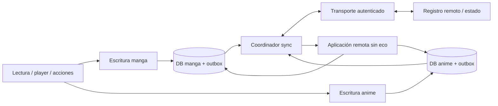

# Auditoría de backup/restore y propuesta de sincronización

Documento posterior: [contrato de sincronización v1 — borrador para revisión](../sync-v1-contract.md),
con 30 decisiones de producto acordadas el 28 de octubre de 2026 y 42 vectores declarativos.
Las propuestas iniciales de las secciones 6–9 se conservan como antecedentes; para el comportamiento
v1 prevalecen las decisiones D01–D30 del contrato. La sección 10 registra el plan actualizado.
El borrador fue contrastado con el chat de decisiones, pero no constituye un protocolo congelado,
implementación ni validación de convergencia.

Auditoría inicial: 27 de octubre de 2026, sobre `dev` y HEAD `056ad94b8025ca255ec31713ae0abe8d97036397`.
Reauditoría: 28 de octubre de 2026, sobre los 118 archivos en staged de
`codex/large-library-database`, HEAD `06a16543042bf10e60c86e81a82a1737c398abbf`.
La reauditoría usó el índice como alcance; al comenzar esa revisión no había diferencias entre índice y árbol
de trabajo. SHA-256 del diff staged binario:
`ae306ebca0f896b3bde96b5d12398f3808fb9957b920779ba0f2321e6f0968b3`.

## 1. Conclusión y alcance

El sistema actual contiene gran parte del **estado que queremos sincronizar**, pero el restaurador
no ofrece las garantías de una sincronización bidireccional. Usarlo periódicamente entre dispositivos
puede recuperar estados desmarcados, reemplazar posiciones recientes por antiguas y perder tiempo
de lectura realizado independientemente en dos dispositivos.

Recomiendo mantener `.tachibk` como mecanismo independiente de recuperación e importación inicial,
y construir un motor incremental que registre cambios junto con las escrituras locales. Las tablas
actuales pueden seguir alimentando la UI. No hace falta unificar las bases de manga y anime.

La revisión cubrió creación, formato, validación, restauración, opciones, preferencias, SQL,
repositorios, lectura/reproducción, historial, estadísticas y tracking. Se investigaron por separado
ambos stacks. Los defectos descritos son hallazgos del código; el diseño de las secciones 6–11 es una
propuesta y todavía no está implementado. Durante la auditoría no se modificó código funcional,
configuración ni cambios previos del usuario; la estabilización posterior se documenta aparte. No se realizó una prueba de dos dispositivos o una auditoría del backend.

La reauditoría confirma que **A1 está corregido** y que ahora hay identidades locales únicas y
columnas `remote_*`, `user_*` y `state_*`. Esto mejora la base de persistencia sin implementar aún
el protocolo de sincronización. En esa reauditoría A2–A8 conservaban sus límites anteriores.
Se añadieron A9–A12 para riesgos y regresiones del staged, distinguiendo reproducciones SQL
de rutas inferidas por código.

La estabilización posterior del 28 de octubre corrige A9–A12 en el árbol de trabajo, conservando
el índice auditado y sin implementar sincronización. Una segunda revisión adversarial encontró
cuatro defectos adicionales y uno heredado, corregidos como A13–A17. Las secciones siguientes describen sus
regresiones y políticas; la validación de estos cambios se registra por separado al final.

La entrega posterior de etapa 0 corrige **A2 y A8 en manga y anime**, incluidos los problemas de
destinatario del tracking encontrados por la revisión adversarial. Se revisaron el informe del chat
de implementación, fuentes, manifiesto de archivos validados, XML de pruebas y evidencias Android.
El índice de esa entrega conserva el SHA-256
`315237cc4b3b4730d9dfb8d3c13493f30da404c214b9b48fdce57a2031748a6a`;
es una línea base posterior, distinta del índice histórico de la reauditoría. Al cierre de esa
entrega los fixes y su actualización documental permanecían sin staging ni commits, y A3–A7 seguían abiertos.

La entrega siguiente corrige **la recuperación y cobertura de A7 en manga y anime**, más dos P2
detectados durante su validación: reexportación de historial no favorito y notificaciones concurrentes.
La etapa 0 queda cerrada dentro del alcance documentado, con pruebas actuales/legacy y preservación
verificada. **A3–A6 siguen abiertos y corresponden al contrato, privacidad y motor de sync**.
La identidad estable de categorías también pertenece a esa fase. No se implementó sincronización.

La revisión del borrador v1 confirma uso personal teléfono/tablet, **AWS serverless con Terraform**,
backend autorizado a procesar el contenido sin E2EE, e historial incluido desde v1. Las estadísticas
de tiempo, preferencias, fuente Local y equivalencias entre fuentes quedan fuera. Drive se reserva
para backups independientes y un eventual transporte futuro. Lambda/API Gateway/DynamoDB son el
diseño de referencia; Cognito es candidato para la cuenta recuperable por correo. Estos componentes
no se han desplegado ni probado en conjunto.

**Etapa 1: decisiones y borrador revisados; cierre técnico pendiente.** Los 42 vectores no se han
ejecutado. A3/A5 tienen reglas propuestas de operaciones/causalidad y A6 una política de incógnito
confirmada, pero sus defectos del código actual siguen abiertos hasta implementarlos y probarlos.
A4 queda fuera del alcance de métricas v1, conservando procedencia para una ampliación futura.
La siguiente entrega recomendada es formalizar modelos y reductores puros y construir el simulador
de dos réplicas; después, persistencia transaccional por stack. No es necesario volver a preguntar
por las 30 decisiones ya confirmadas.

## 2. Qué tenemos hoy

| Área | Manga | Anime | Límite para sincronización |
| --- | --- | --- | --- |
| Biblioteca | Fuente, URL, favorito, fecha de alta y metadatos | Equivalente | Identidad local por fuente/URL; no hay identidad global de obra |
| Progreso | Leído y última página | Visto, posición y duración del episodio | Es estado actual; no conserva intención ni ciclos de relectura |
| Marcas | Bookmark | Bookmark y filler | Desmarcar necesita una operación explícita |
| Historial | Última fecha y duración acumulada por capítulo | Última fecha por episodio | Una fila por unidad, sin sesiones individuales |
| Categorías | Nombre, orden, flags, hidden y asignaciones | Equivalente | IDs locales y merge por nombre; sin identidad estable compartida |
| Configuración por entrada | Flags del lector, capítulos, estrategia, scanlators excluidos, memo | Flags del player, episodios y temporadas | El esquema clasifica memo como `remote_memo`; no asumir que es una nota personal |
| Series/temporadas | No aplica | Relaciones padre-hijo y atributos de temporada | Los IDs del backup solo sirven para remapear dentro de ese archivo |
| Tracking externo | Proveedor, IDs, progreso, score, estado, fechas, privacidad | Equivalente | No sustituye biblioteca, historial o métricas multidispositivo |
| Preferencias | App y fuentes configurables instaladas | Compartidas o paralelas según clave | Seis tipos; privados optativos; sin política de conflictos |
| Extensiones | Repositorios y APKs opcionales | Equivalente | Las APKs no son necesarias para sincronizar el estado personal |
| Botones mpv | No aplica | Contenido y configuración de botones | Deben tener tratamiento separado por contener comandos |
| Descargas/archivos | No se exportan los archivos ni la cola de descargas en el contrato | Equivalente | Deben tratarse como recursos locales o como una función adicional |

Evidencia: [BackupManga.kt, líneas 11–44][backup-manga], [BackupAnime.kt, 11–51][backup-anime],
[BackupChapter.kt][backup-chapter], [BackupEpisode.kt][backup-episode],
[Backup.kt, 44–62][backup-root], [PreferenceBackupCreator.kt, 31–85][pref-create],
[ExtensionsBackupCreator.kt, 18–46][extensions-create].

Con `libraryEntries=true`, la selección incluye favoritos y, si se habilita `readEntries`, entradas
fuera de biblioteca con leído/visto, posición distinta de cero o historial. El último caso se añadió
en A7 para conservar títulos cuyo historial se recuperó sin importar progreso. `readEntries=false`
excluye esos no favoritos y `libraryEntries=false` no exporta títulos. **No exporta indiscriminadamente
todas las filas**: memo o bookmark por sí solos no garantizan inclusión.
Ver [manga.sq][mangas-sql] y [anime.sq][animes-sql].

### Flujo de backup/restore

1. `BackupCreateJob` ejecuta la creación. Los creadores recorren entradas en lotes de 100 con límite
   superior de ID, consultan datos relacionados y emiten un título cada vez.
2. `BackupWriter` escribe protobuf comprimido con gzip. Mantiene el formato existente y evita
   cargar toda la biblioteca a la vez. Preferencias/APKs y demás metadatos tienen un manejo distinto.
3. Se valida el archivo generado; el decoder acepta protobuf crudo/gzip y formatos legacy.
4. Restore lee metadatos y almacena las entradas en un archivo temporal antes de aplicar cambios.
5. Restaura categorías, preferencias y entradas. Manga y anime pueden ejecutarse en paralelo;
   las temporadas anime se ordenan para restaurar padres antes que hijos y se detectan ciclos.
6. Cada título se restaura en una transacción de su base. Los errores por título se acumulan y el
   proceso continúa. No hay una transacción global que abarque las dos bases y preferencias.

Ver [BackupCreator.kt, 65–136][backup-create], [MangaBackupCreator.kt, 23–60][manga-create],
[AnimeBackupCreator.kt, 21–55][anime-create], [BackupStream.kt, 16–44 y 141–155][backup-stream],
[BackupRestorer.kt, 120–244][backup-restore] y [AnimeRestorePlan.kt][anime-plan].

La bandera `sync` de `BackupRestoreJob` llega a las notificaciones; **no implementa intercambio,
reconciliación ni transporte remoto**. Las tablas ahora llamadas `manga_track`/`anime_track`
(antes `manga_sync`/`anime_sync`) son vínculos con trackers.
Ver [BackupRestoreJob.kt, 38–47 y 80–95][restore-job].

### Cambios de esquema verificados en staged

- Migraciones [34.sqm][migration-manga] (manga, versión 34 → 35) y
  [136.sqm][migration-anime] (anime, 136 → 137): tablas singulares, columnas clasificadas por
  procedencia y reconstrucción/deduplicación de relaciones.
- Unicidad de títulos por `(source_id, remote_url)`, hijos por `(parentId, remote_url)` y pertenencias
  por título/categoría. Los repositorios resuelven el ID canónico tras insertar; no se apoyan en
  `last_insert_rowid()` cuando el conflicto hace que no se inserte una fila nueva.
- Biblioteca con una fila por título y `categories: List<Long>`; UI, jobs, estadísticas y almacenamiento
  adaptan pertenencia y exclusión de categorías. No es una nueva identidad global entre dispositivos.
- Apertura de ambas bases en IO con [DatabaseInitializer][db-initializer] y
  [DatabaseMigrationCallback][db-callback], estado de error y reintento en MainActivity.
- Los modelos/ProtoNumbers y el framing del backup no cambian: los creadores mapean los nuevos
  nombres SQL a los mismos campos serializados. Persisten dos bases y sus secuencias independientes.

La migración fusiona duplicados de la base, pero **el restore de duplicados dentro de una entrada
del backup no aplica la misma política**; ver A9. Para la preservación de categorías no favoritas,
ver A10. La nomenclatura nueva no añade sesiones, tombstones, outbox ni causalidad.

## 3. Hallazgos que conviene corregir o resolver antes de integrar sync

La prioridad indica el orden recomendado para este proyecto. Los límites de sync no implican por
sí solos que el comportamiento conservador de recuperación sea incorrecto para un backup.

### A1. Corregido en staged: historial acotado al título y URL

La búsqueda global por URL encontrada el 27 de octubre ya no describe el código nuevo.
`restoreHistory` recibe `mangaId`/`animeId` y los utiliza tanto para consultar historial como para
resolver el capítulo/episodio. Las restricciones UNIQUE de hijos también acotan duplicados por padre.

Evidencia actual: [MangaRestorer.kt, 322–334][manga-restore],
[AnimeRestorer.kt, 342–354][anime-restore], [history.sq, 27–36][history-manga] y
[anime_history.sq, 25–34][history-anime]. Las pruebas de
[LibraryRepositoryIntegrationTest.kt, 192–243][library-integration-test] distinguen dos padres con
la misma URL. Cubren las consultas reales, no un roundtrip completo del restaurador Android.

### A2. Corregido: remapeo de preferencias de categorías separado por stack

Antes del fix, `BackupRestorer` entregaba solo las categorías manga a `restoreApp`, que también
usaba ese mapa para anime. Ahora espera a terminar ambos restauradores de categorías y entrega
`backupCategories` y `backupAnimeCategories` por separado. `PreferenceRestorer` remapea
ID de backup → nombre → ID local únicamente en el stack al que pertenece cada clave.

Las doce claves quedan clasificadas explícitamente: dos categorías predeterminadas y diez conjuntos
de biblioteca/descargas. Se conservan categoría 0 y predeterminado -1. Si no se restauran categorías,
o falta el ID/nombre correspondiente, no se importan referencias crudas ni se consulta el otro mapa.
Los conjuntos mantienen la unión de restore existente: un conjunto vacío no borra selecciones
locales. Esa preservación no representa una operación de quitar categorías para sync; A3 sigue abierto.

Las preferencias de fuentes no reciben remapeo de claves de aplicación. Se conservan los seis tipos
de preferencias y sus discriminadores, las claves existentes y el contrato protobuf.
`PreferenceRestorerTest` añade 21 casos, con ambas pilas, IDs coincidentes/distintos, vacíos,
categorías deseleccionadas, referencias ausentes, tipos y preferencias no relacionadas.
Ver [BackupRestorer.kt][backup-restore], [PreferenceRestorer.kt][pref-restore] y
[PreferenceRestorerTest.kt][pref-restore-test]. La validación Android se detalla en la sección 12.

### A3. Bloqueante para sync: unión y máximos no propagan la intención del usuario

Favorito/bookmark y leído/visto se conservan mediante unión de estados verdaderos. Anime también
conserva filler. Un dispositivo que desmarque o quite algo no puede propagar de forma fiable ese
cambio mediante restore. Las asignaciones de categorías solo se reemplazan si la lista resultante
no está vacía: quitar todas tampoco queda representado. Scanlators excluidos se unen.

Además, una posición no nula de un backup antiguo puede sustituir una posición local posterior
cuando ambos capítulos/episodios siguen incompletos. El merge de progreso no arbitra con una revisión
causal; `forComparison` excluye timestamp y versión. La restauración no es conmutativa en general.

Ejemplo: A tiene página 80; B aporta página 20 de un estado antiguo. Aplicar B puede dejar página 20.
Tomar siempre el máximo tampoco resuelve volver atrás deliberadamente o iniciar una relectura.

Ver [MangaRestorer.kt, 82–101, 145–188, 294–319 y 424–434][manga-restore],
[AnimeRestorer.kt, 83–104, 154–198 y 314–339][anime-restore] y
[SetReadStatus.kt, 21–34][set-read]/[SetSeenStatus.kt, 21–34][set-seen].

### A4. Bloqueante para métricas: acumulados sin procedencia no admiten una fusión exacta

Manga acumula `time_read`; restore toma el máximo entre los totales. Si ambos dispositivos parten
de 100 unidades y añaden 20 y 30, el resultado actual es 130; la actividad independiente sumaría
150. Sumar 120 + 130 daría 250 y duplicaría la base común. Ninguna fórmula sobre esos dos totales
puede descubrir qué parte comparten.

Anime no conserva tiempo activo ni sesiones en `anime_history`. El campo `readDuration` del modelo
de backup anime no se rellena con tiempo real de reproducción. No es posible reconstruir sesiones
pasadas que nunca se registraron.

Ver [history.sq, 3–9 y 75–87][history-manga], [MangaRestorer.kt, 338–355][manga-restore],
[anime_history.sq, 3–8][history-anime], [AnimeBackupCreator.kt, 101–102][anime-create] y
[BackupAnimeHistory.kt, 9–17][backup-anime-history].

### A5. Bloqueante para sync: versiones y timestamps actuales son parciales

Hay `version`, `last_modified_at` e `is_syncing`, pero no constituyen un registro completo de cambios:

- Títulos: el incremento de versión cubre URL, descripción y favorito; no todos los atributos.
- Capítulos/episodios: cubre leído/visto, bookmark y posición; no todos los datos, como filler.
- Asociaciones de categoría: hay incremento al insertar, pero quitar una asociación no tiene el mismo efecto.
- Historial y borrados no tienen un mecanismo equivalente de revisión/tombstone.
- Los timestamps de esos triggers usan segundos del reloj local. Las inserciones SQL parten con
  `last_modified_at=0`; no sirven como cursor incremental completo.
- Dos contadores locales iguales no representan el mismo estado ni ordenan cambios de dispositivos distintos.

Reproducciones SQLite sobre los triggers reales confirmaron que cambiar título/memo o filler no
incrementa versión, y que insertar una categoría incrementa pero borrarla no. La aplicación remota
tampoco debe reutilizar sin adaptación repositorios que fuerzan `isSyncing=0`.

Ver [manga.sq, 39–65][mangas-sql], [anime.sq, 47–73][animes-sql],
[chapter.sq, 29–53][chapters-sql], [episode.sq, 31–54][episodes-sql],
[manga_category.sq, 12–17][manga-categories-sql],
[ChapterRepositoryImpl.kt, 70–87][chapter-repo] y [EpisodeRepositoryImpl.kt, 70–90][episode-repo].

### A6. Alta para privacidad: incógnito tiene semánticas distintas

Reader evita persistir progreso e historial en incógnito. Player evita historial, pero guarda
progreso si `!incognitoMode || hasTrackers`. Puede ser una decisión deliberada del player, pero una
outbox que observe todas las escrituras subiría progreso de una sesión en incógnito.

La captura necesita contexto de privacidad y origen. Decidir explícitamente si ese progreso local
queda excluido también de futuras instantáneas de sincronización; excluir solo el evento inmediato
no basta si después se vuelve a exportar toda la fila.

Ver [ReaderViewModel.kt, 606–620 y 663–671][reader] y
[PlayerViewModel.kt, 1977–1982 y 2090–2115][player].

### A7. Corregido: recuperación de historial, hidden, solo extensiones y reporte de errores

**Historial sin capítulos/episodios:** `BackupHistory.chapter` y `BackupAnimeHistory.episode`
añaden metadatos opcionales en `@ProtoNumber(4)`. Con `history=true` se exporta identidad suficiente
para crear un hijo faltante bajo su padre exacto, aunque `chapters=false`. Se sanea al exportar y
al insertar: sin progreso, leído/visto, bookmark, filler, duración de reproducción, versión ni memo.
Un hijo ya existente conserva su estado. Padre por fuente+URL e hijo por padre+URL evitan mezclar
fuentes o títulos que comparten una URL de capítulo/episodio.

Si un archivo legacy no contiene datos suficientes y falta el hijo local, la omisión se informa en
el resumen/log y continúa la recuperación parcial. No se inventan hijos. Una app anterior puede
ignorar el campo nuevo y conserva su limitación de recuperación original. Los queries de backup
incluyen historial al seleccionar no favoritos con `readEntries=true`: exportar → restaurar sin
progreso → reexportar ya no elimina esos títulos del backup siguiente.

**Categorías ocultas:** `BackupCategory.hidden: Boolean?` ocupa `@ProtoNumber(101)`, preservando
1/2/3/100. Un valor presente restaura visibilidad en categorías nuevas y existentes de ambas pilas;
ausencia legacy conserva la visibilidad local y deja visible una categoría nueva. Las copias del
mismo nombre no crean filas adicionales. Continúa el merge por nombre y la política local de
orden/flags; identidad estable, renombres y vacío como intención quedan para sync.

**Solo extensiones:** `BackupOptions.canCreate()` incluye APKs. Creación, gzip, detector, lector de
metadatos, validación y restore admiten backups sin títulos. Ninguna selección deshabilita Create;
un marcador de formato sin contenido no cuenta como backup válido. Si no hay APKs disponibles ni
otro contenido seleccionado, el export vacío se rechaza y elimina. El detector distingue APK legacy
y repositorios que comparten número de campo, sin decodificar el payload APK para decidir la forma.

**Errores de preferencias:** app y fuentes devuelven incidencias por ámbito/ordinal al resumen/log
de `BackupRestorer`, conservando recuperación parcial. Se informa fallo de apertura/lectura,
remapeo, escritura o programación sin incluir claves, sourceKey, valores ni texto de excepción.
Omisiones intencionales por tipo incompatible o mapas ausentes no se convierten en errores;
cancelación se propaga. Se conservan los seis tipos/discriminadores y los doce remapeos A2.

La validación cerró además una carrera de `BackupNotifier`: el progreso concurrente manga/anime
podía modificar un builder mientras se construía su notificación. Ahora se serializan mutación,
construcción y publicación; `BackupRestoreJob` recibe un snapshot `Notification`, sin reconstruir
fuera del bloqueo. No se promete evitar las cuotas de entrega de notificaciones de Android.

Ver [historial manga][backup-history], [historial anime][backup-anime-history],
[categorías][backup-category], [opciones][backup-options], [restaurador manga][manga-restore],
[restaurador anime][anime-restore], [preferencias][pref-restore] y [notificador][backup-notifier].
La sección 12 registra 119 regresiones nuevas, probes adversariales y el APK exacto probado.

### A8. Corregido: aislamiento, destinatarios y reintentos de tracking

Antes del fix, ambas colas compartían `tracking_queue` y claves numéricas de bases independientes.
Ahora usan `tracking_queue_manga` y `tracking_queue_anime`, con un store común que aísla lectura,
escritura y confirmación. Los valores siguen siendo Float. Las claves versionadas registran fila,
título, proveedor, ID remoto, libraryId, URL y el login observado mediante `getUsername()`.

La revisión adversarial reprodujo además un P1 en ambas pilas: reutilizar un rowID o cambiar el
vínculo remoto de la misma fila podía enviar el progreso anterior al nuevo destinatario.
La corrección exige identidad coincidente antes del envío y persistencia condicional dentro de una
transacción de la base. Una respuesta en vuelo no sobrescribe un vínculo reemplazado, y cada
destinatario/login conserva sus pendientes por separado. La resolución válida de libraryId
null/0 → positivo admite un alias durable después de la escritura condicional, conservando progreso
concurrente y productores con una identidad anterior del mismo destinatario.

`TrackChapter` y `TrackEpisode` guardan y programan el pendiente antes de la llamada al servicio.
Los fallos online de anime, refresh, actualización o persistencia local conservan el trabajo.
Los locks entre instancias y la confirmación condicionada al progreso evitan borrar un pendiente
posterior. Los workers procesan el vínculo exacto y mantienen red requerida/backoff, sin el antiguo
límite de tres reintentos. `ExternalIntents` delega en `TrackEpisode`, eliminando también una ruta
que encolaba animeId como si fuera trackId.

**Política legacy y límites:**

- `tracking_queue` original se conserva sin reescritura ni envío automático: sus IDs no permiten
  inferir de forma segura stack, destinatario y cuenta. La migración histórica de preferencias
  deja de transformarlo. Las claves nuevas inválidas o sin identidad también se conservan sin replay.
- Una consulta nula no distingue borrado de fallo de DB; los huérfanos y vínculos no coincidentes
  pueden quedar retenidos indefinidamente. No se añadió una herramienta de recuperación manual.
- El login registrado es una protección conservadora: cambios de nombre pueden retener trabajo,
  y trackers de fuentes con usuario genérico no exponen una identidad universal de cuenta.
  Cambiar credenciales durante una petición ya en vuelo no puede deshacer su efecto remoto.
- No hay transacción conjunta entre SQLite, SharedPreferences y WorkManager ni garantía de entrega
  exactamente una vez. Un cierre entre persistir libraryId y transferir/confirmar la cola puede
  conservar trabajo pendiente sin replay. Tampoco hay generaciones para distinguir un vínculo
  eliminado y recreado con toda la misma identidad observada.

Estas son colas de reintentos de trackers, **no la outbox de sync**. Ver
[store común][tracking-store], [identidad de destinatario][tracking-identity],
[store manga][manga-queue], [store anime][anime-queue],
[TrackEpisode.kt][track-episode] y [TrackChapter.kt][track-chapter]. La sección 12 registra
regresiones, revisión adversarial y límites de las pruebas Android.

### A9. Corregido, P1: restore de hijos duplicados de backups anteriores

El esquema anterior permitía capítulos/episodios con igual URL bajo el mismo padre. Antes del fix,
restaurarlos sobre un destino vacío conservaba solo la primera copia por `ON CONFLICT DO NOTHING`,
perdiendo el estado de las copias siguientes. Se reprodujo originalmente con los INSERT reales.

Ambos restauradores ahora fusionan por URL antes de clasificar las filas existentes y nuevas:
OR de leído/visto, bookmark y filler; máximo de progreso/duración, fecha de publicación y modificación;
primera copia para nombre, número y orden, completando metadatos opcionales nulos o vacíos; fecha de
obtención mínima positiva. Memo manga une claves con prioridad de la primera copia; los datos
locales tienen prioridad de conflicto al restaurar sobre un capítulo existente. El progreso local
más avanzado se conserva. Scanlator, resumen y preview locales no vacíos tienen prioridad; si
faltan, también se completan al actualizar una fila existente. La política deriva de Mihon `6ee529c5aa5872231984666bf1e63402c56c6ce1`
y `306befb214c497c4ebd162d3d613fc0528a0c72d`, extendida a los campos de anime.

También se agrupa el historial repetido por URL: fecha máxima y, en manga, suma del tiempo de las
copias antes de combinar por máximo con el acumulado local. Repetir el mismo restore no vuelve a
sumarlo. Esto no soluciona la causalidad de A3 ni convierte el restore en sincronización.

`DuplicateBackupRestoreTest` ejecuta ocho casos: protobuf `LegacyBackup` y formato actual, destino
vacío/existente, manga/anime y dos restores consecutivos por caso. Usa restauradores, repositorios
y SQLite reales; comprueba unicidad, progreso, marcas, memo, campos anime e historial. El contrato
protobuf permanece sin cambios. Ver [MangaRestorer.kt][manga-restore] y [AnimeRestorer.kt][anime-restore].

### A10. Corregido, P2: categorías válidas de títulos no favoritos

Las migraciones copiaban pertenencias solo de copias favoritas y perdían categorías incluso sin
duplicados. Las migraciones 34/136 ahora conservan todas las pertenencias válidas cuando el grupo
completo está fuera de biblioteca. Si alguna copia es favorita, se mantiene la unión exclusiva de
categorías de las copias favoritas, evitando recuperar categorías obsoletas de copias retiradas.
Se mantiene la exclusión de relaciones huérfanas y el colapso de pertenencias duplicadas.
Política contrastada con Mihon `93cc07511`, migración 17.

`LibrarySchemaPreservationTest` añade seis casos sobre fixtures y migraciones reales: retirar →
migrar → reincorporar, duplicados todos no favoritos y grupos mixtos, en manga y anime. Se comprueban
las pertenencias, la vista de biblioteca al reincorporar, integridad y claves foráneas.
Ver [34.sqm][migration-manga] y [136.sqm][migration-anime].

### A11. Corregido, P2: aperturas de background antes de completar la migración

La ruta original se identificó por inspección: los constructores de workers podían resolver un
SourceManager que suscribe SQL fuera del coordinador de apertura. No se había reproducido un crash
Android. La protección ahora vive en los dos `Android*DatabaseHandler`: esperas y suscripciones
esperan `DatabaseInitializer.awaitReady()` antes de construir consultas o acceder al driver.
Eso cubre también las suscripciones de SourceManager y el registro de stubs. El coordinador abre
los drivers directamente, por lo que no espera su propia barrera ni introduce un ciclo de DI.

Los cuatro workers de biblioteca/metadatos resuelven dependencias de forma diferida. Antes de usarlas,
`awaitReadyOrFailure()` espera el resultado inicial y devuelve `Result.retry()` si falla una migración.
Las suscripciones permanecen suspendidas durante el fallo y continúan al recuperar con reintento;
no se captura silenciosamente una excepción SQL ni se borra la base.

Las pruebas unitarias construyen los cuatro workers antes de fallar manga/anime, comprueban retry
sin construir dependencias y continuación tras recuperar. Los tests de handlers comprueban bloqueo
de driver/consultas, reanudación de los tres tipos de suscripción y cancelación; el coordinador prueba
un consumidor que sobrevive fallo → reintento. La prueba de arranque Android completo se registra
separadamente en la validación final. Ver [AppModule.kt][app-module],
[MangaLibraryUpdateJob.kt][manga-update-job] y [AnimeLibraryUpdateJob.kt][anime-update-job].

### A12. Corregido, P2, UI: ancla de selección por rango

Desmarcar B tras seleccionar A y B anulaba la categoría del ancla; mantener pulsado D añadía solo D.
Ambos ScreenModels ahora conservan ID y categoría de cada ancla seleccionada. Al retirar una entrada,
se recupera el ancla restante con su categoría original. Seleccionar todo e invertir selección
actualizan también las anclas, y un rango inverso recuerda el título pulsado como nueva ancla.
No se cruza de categoría por compartir un título y un ancla oculta por filtros no crea un rango falso.

`MangaLibrarySelectionTest` y `AnimeLibrarySelectionTest` añaden nueve casos por stack sobre las
transiciones reales de `State` usadas por los ScreenModels, además de los tests existentes del helper.
Cubren el escenario A,B,desmarcar B,D, desmarcar otro título, procedencia de categoría, rangos inversos,
selección masiva/inversión, vaciado, target ya seleccionado y ancla filtrada. Revisión independiente
sin hallazgos funcionales. Ver [MangaLibraryScreenModel.kt][manga-library] y
[AnimeLibraryScreenModel.kt][anime-library].

### A13. Corregido, P2: colas con IDs descartados durante la deduplicación

Las migraciones 34/136 conservan un alias durable por pareja padre/hijo antigua, incluidos los IDs
que no cambiaron. Las tablas auxiliares de ambas bases apuntan al hijo canónico; `ON DELETE SET NULL`
mantiene un tombstone si se elimina, para que una cola vieja no termine asociada a un ID reutilizado.
Las migraciones 35/137 instalan las tablas en builds anteriores del feature; los esquemas finales
son manga 36 y anime 138. El índice de `item_id` evita escanear todos los aliases en cada borrado.

`DownloadQueueMigration` resuelve padre e hijo. Los Stores solo remapean registros legacy, escriben
una versión de identidad opcional y deduplican conservando orden y error. Los pendientes no resueltos
por fuente o consulta fallida se conservan. El commit valida el snapshot para respetar cancelaciones
y cambios concurrentes. Las claves nuevas separan manga/anime dentro del archivo compartido
`active_downloads`; limpiar una pila conserva la otra. Los downloaders esperan las fuentes.

`DownloadQueueMigrationTest` añade 21 casos con Stores y SQLite reales, incluyendo fuente ausente,
reintento, ID reutilizado, deduplicación, orden/error, clear/remove/replacement concurrentes y dos
pilas con el mismo ID. Los cuatro casos adicionales verifican publicación atómica frente a clear/remove.
`DownloadQueueAliasMigrationTest` añade seis casos de migración real.

### A14. Corregido, P2: pérdida de claves exclusivas de memo en la migración manga

La migración 34 prepara memos únicamente de grupos duplicados. `MangaLibraryMigration.mergeMemos`
se ejecuta como callback `AfterVersion(34)` dentro de la transacción de upgrade, antes del commit.
Une claves JSON del primer nivel con prioridad de la primera copia, preservando tipos, objetos
anidados y `null`. Procesa un grupo cada vez y evita depender de extensiones JSON de SQLite.

Los dos triggers de timestamps se retiran y restauran con su SQL original dentro de esa transacción,
para no transformar la fusión en una modificación posterior del usuario. Los memos únicos inválidos
no se interpretan ni alteran; los inválidos de grupos duplicados abortan con diagnóstico y rollback.
El helper limpia el staging temporal antes de terminar. Anime no tiene un campo memo equivalente.

### A15. Corregido, P2: campos vacíos ocultan metadatos de otras copias al migrar

Las migraciones 34/136 prefieren el primer valor no vacío, incluyendo whitespace Unicode, y mantienen
el orden de prioridad entre valores válidos. Si no hay alternativa válida se conserva el valor
original, para no reescribir registros únicos. Cubre detalles de títulos y scanlator en ambas pilas,
y resumen/preview/background de anime. No cambia el contrato de extensiones ni de backup.

`LibraryMetadataMigrationTest` añade 12 casos para A14/A15: metadata, fallback sin alternativa,
objetos memo con conflictos y tipos JSON, timestamps/versiones/triggers, memos únicos inválidos y
seis variantes de fallo en duplicados con rollback completo.

### A16. Corregido, P2: retorno del reproductor externo bloquea la recuperación

El callback de MainActivity ya no usa `runBlocking`. `ExternalPlayerResultViewModel` conserva una cola
de resultados, sus IDs y la versión de identidad en `SavedStateHandle`; espera la inicialización
sin bloquear main, por lo que la pantalla de error puede recibir Retry. El consumidor se conserva
al rotar y los resultados pendientes se recuperan tras recrear el proceso. Espera también las fuentes,
reinicializa el episodio correcto y evita aplicar progreso si ya no existe el target.

Los IDs guardados por versiones anteriores se resuelven con los aliases de A13; los actuales no se
vuelven a remapear. Un target eliminado nunca se sustituye por un ID reutilizado. Este cambio aplica
solo a anime: manga no tiene el flujo de devolución de un reproductor externo.

`ExternalPlayerResultViewModelTest` añade seis casos de fallo→Retry, reconexión de actividad,
recreación de estado pendiente, orden/target de varios resultados, target ausente e inputs inválidos.
La prueba Android del ActivityResult se registra en la validación de esta segunda estabilización.

### A17. Corregido, heredado: categorías de títulos repetidos dentro del mismo backup

`BackupRestoreStore` agrega categorías por sesión, stack y pareja source+URL mientras genera el spool.
Cada copia se lee con la unión definitiva del grupo: solo copias favoritas si existen; todas las no
favoritas si el grupo no tiene ninguna favorita. El orden no provoca sobrescrituras. No une categorías
locales indiscriminadamente ni mezcla dos backups sucesivos. Las categorías vacías y la opción de no
restaurarlas mantienen su semántica previa. Los hijos siguen en disco; solo se agregan identidades y
pertenencias, conservando los IDs del backup y la planificación de temporadas.

`DuplicateTitleCategoryRestoreTest` añade 36 casos con restauradores/repositorios/SQLite reales:
ambas pilas, formatos legacy/actual, orden inverso, favoritos/no favoritos/mixtos/default, fuentes y
URLs distintas, snapshots sucesivos, estado local y categorías desactivadas; se repite cada restore.

## 4. Qué significan hoy las métricas

| Indicador | Cálculo actual | Interpretación y consecuencia |
| --- | --- | --- |
| Tiempo manga | Suma de `history.time_read` de todo el historial | Acumulado local; no conserva sesiones; puede perderse con borrado físico |
| Tiempo anime | Duración total si visto; posición si pendiente, en títulos de biblioteca | Estimación de contenido avanzado; seek, marcas manuales y rewatch alteran su significado |
| Contadores de biblioteca | Agregados de títulos, capítulos/episodios y marcas actuales | Deben recalcularse sobre entidades deduplicadas, no sumarse entre dispositivos |
| Descargas | Archivos locales y estado del gestor | Deben seguir indicando el dispositivo actual |
| Scores/tracking | Vínculos y datos de proveedores disponibles | Los servicios externos tienen su propia política y autenticación |

Las columnas anime `lastSecondSeen`/`totalSeconds` reciben **milisegundos**:
`PlayerViewModel` multiplica los segundos de mpv por 1000. El nuevo contrato debe indicar unidades
explícitas (`positionMs`, `durationMs`, `activeMs`) y evitar copiar los nombres engañosos.
Ver [PlayerViewModel.kt, 1969–1973][player], [AnimeStatsScreenModel.kt, 42–69 y 116–128][anime-stats]
y [MangaStatsScreenModel.kt, 52–69][manga-stats].

Quitar una entrada del historial puede poner su fecha en cero conservando duración; borrar todo
el historial elimina filas. La sincronización debe distinguir **ocultar del historial**, **borrar
actividad** y **reiniciar métricas**. Un backup antiguo no debe resucitar un borrado confirmado.
Ver [history.sq, 38–73][history-manga] y [anime_history.sq, 35–70][history-anime].

## 5. Atomicidad, formato y seguridad

Fortalezas reutilizables: streaming por título, lectura legacy, remapeo de IDs, spool temporal,
orden de temporadas y transacciones por entrada. El spool tiene acceso sincronizado y se elimina
al cerrar. No conviene sustituir estas garantías por un simple intercambio de archivos SQLite.

Límites confirmados del código:

- Las consultas de exportación se ejecutan por lotes y por relaciones, sin una instantánea global
  de ambas bases y preferencias. Una instantánea mixta bajo escrituras concurrentes es un riesgo
  inferido de ese flujo; no se reprodujo en dispositivo.
- El destino se escribe directamente y se valida después. El backup automático elimina versiones
  antiguas antes de terminar la nueva. Un fallo puede reducir la retención.
- El archivo se comprime, pero no se cifra ni autentica en esta capa. Los privados se excluyen
  por la marca de su clave, no mediante una lista explícita de información apta para nube.
- `BackupReader` permite longitudes hasta `Int.MAX_VALUE` sin cuotas prácticas para tamaño
  descomprimido/entradas. Las APKs se cargan juntas en memoria. La ingestión remota necesita límites.
- Restore puede terminar con errores por entrada y aun así el worker devolver `success`. Para sync
  hacen falta confirmaciones estructuradas por operación y un cursor que no avance sobre errores.

Evidencia: [BackupCreator.kt, 70–77, 86–136][backup-create],
[BackupStream.kt, 127–134 y 194–197][backup-stream], [BackupRestoreStore.kt][restore-store],
[BackupRestoreJob.kt, 46–56][restore-job] y [PreferenceBackupCreator.kt, 63–85][pref-create].

Compatibilidad a conservar: números protobuf y números retirados, valores por defecto, formatos
legacy y nombres serializados de las seis clases `PreferenceValue`. No reutilizar una clave de
preferencia con otro tipo. Añadir un campo raíz también exige revisar `METADATA_FIELDS` del lector;
modificar únicamente `Backup` puede hacer que se descarte en el paso de metadatos.
Ver [Backup.kt][backup-root], [BackupPreference.kt][backup-pref] y
[BackupStream.kt, 219–221][backup-stream].

## 6. Arquitectura propuesta — antecedente del contrato v1

La separación de bases, outbox transaccional por stack y aplicación sin eco se conservan en el
[contrato v1, sección 8](../sync-v1-contract.md#8-persistencia-local-y-aplicación-sin-efectos-secundarios).
La selección de alojamiento ya avanzó: AWS serverless/Terraform están confirmados; la arquitectura
y las garantías operativas concretas siguen sujetas a implementación y pruebas.

Propuesta: **estado local + operaciones incrementales + proyecciones actuales + transporte intercambiable**.
La UI continúa leyendo localmente. En la propuesta inicial el backend estaba pendiente de selección;
el motor conserva reglas de dominio separadas del adaptador de transporte elegido.



Cada cambio local debe escribir **estado y outbox en la misma transacción de su base**. Hay dos
drivers/archivos SQLite independientes ([AppModule.kt, 87–120][app-module]); colocar toda la outbox
en una tercera base introduciría escrituras dobles sin atomicidad con manga/anime. Un coordinador
común puede drenar ambas colas sin fusionar los modelos de dominio.

Aplicar datos remotos debe actualizar proyección, deduplicación y cursor de ese stack en una
transacción, sin volver a emitir el cambio. Si el servidor entrega un stream mixto, conservar
checkpoints por stack o una recepción durable que permita reanudar tras aplicar solo uno.

El bootstrap y la resincronización necesitan una instantánea consistente **por stack** asociada
a su watermark/cursor. Las escrituras posteriores deben quedar registradas y reproducirse desde
ese corte. Exportar filas por lotes y después fijar el cursor a «ahora» puede omitir cambios ocurridos
durante la exportación. No se requiere una instantánea atómica entre ambas bases, pero sí un corte
verificable e independiente para cada una.

Separar borrados técnicos de intención personal: que una fuente deje de devolver un capítulo no
significa que el usuario quiera borrar su lectura. Las tablas actuales de historial tienen
`ON DELETE CASCADE`; las sesiones nuevas deben poder conservar su identidad y metadatos mínimos
aunque desaparezca la fila del catálogo local. Definir aparte eliminación de biblioteca y borrado
de actividad solicitado por el usuario.

Para preferencias globales sincronizadas conviene una tabla explícita transaccional como fuente
de verdad y una proyección hacia las preferencias existentes. Observar SharedPreferences y luego
escribir una outbox en otra base deja una ventana de pérdida. Empezar sin preferencias en el MVP.

Este enfoque es coherente con la guía oficial de [aplicaciones offline-first de Android](https://developer.android.com/topic/architecture/data-layer/offline-first),
que sitúa lectura local, escrituras encoladas y resolución de conflictos en la capa de datos.
Los detalles de outbox y reglas aquí descritos son una propuesta específica para este repositorio.

### Contrato mínimo propuesto

| Concepto | Campos o responsabilidad |
| --- | --- |
| Identidad | `entityId`, tipo manga/anime/capítulo/episodio, `parentEntityId`, aliases de fuente/URL |
| Operación | `operationId`, `deviceId`, secuencia por dispositivo/stream, tipo, payload y versión de protocolo |
| Conflicto | Revisión/contexto causal conocido, orden lógico y desempate determinista documentado |
| Outbox | Payload durable, estado pendiente/confirmado, reintentos; una por base |
| Inbox/aplicados | ID único de operación recibida y checkpoint, para idempotencia |
| Borrado | Tombstone o marcador de borrado con revisión y alcance |
| Sesión | `sessionId`, dispositivo, unidad, ciclo, checkpoint, duración activa acumulada, UTC de ocurrencia |
| Estado visible | Tablas actuales, actualizadas como proyecciones compatibles con la UI |

El backend debe autenticar y aislar cada cuenta/colección, aceptar reintentos con el mismo
`operationId` una sola vez y ofrecer paginación/cursor durable. El orden de recepción del servidor
por sí solo no expresa cuándo ocurrió una acción offline. No usar el reloj civil del teléfono ni
`version` actual como único árbitro.

### Identidad y equivalencias

Los `_id` SQLite no viajan como identidad compartida. Mapear una edición por
`(mediaType, sourceId, sourceUrl)` y sus hijos por `(parentEntityId, itemUrl)`, con IDs de sync
estables. Dos dispositivos que incorporan independientemente la misma edición deben converger:
el servidor puede hacer alta idempotente por esa clave, o el protocolo establecer una identidad
determinista con codificación canónica. UUIDs independientes sin reconciliación crearían duplicados.

Deduplicar esa clave en claro en el servidor revela la identidad del contenido. Si se elige cifrado
de extremo a extremo, resolver equivalencias en clientes o usar identificadores opacos deterministas
derivados con una clave compartida, documentando que pueden revelar igualdad. Un servidor que solo
ve ciphertext no puede ejecutar los mismos merges semánticos de un servidor que conoce los campos.

No identificar por título o número de capítulo/episodio. Fuentes, idiomas, extras y scanlators
pueden diferir. Conservar aliases cuando una fuente cambie de URL; no normalizar URLs agresivamente.
La equivalencia de una obra entre fuentes diferentes requiere vinculación explícita o un proveedor
de IDs, y debe ser una fase adicional. Para archivos locales, usar asociación explícita/manifiesto
o huella del contenido cuando sea viable; las rutas de cada dispositivo no son identidad universal.

Las temporadas anime deben referenciar `parentEntityId`; el remapeo/topología existente es reutilizable,
pero `BackupAnime.id` solo sirve dentro del archivo. No requiere cambiar la API pública de extensiones.

## 7. Reglas de conflicto propuestas — antecedente del contrato v1

La tabla siguiente conserva la propuesta inicial. El [contrato v1, secciones 4–7](../sync-v1-contract.md#4-operaciones-causalidad-y-conflictos--diseño-derivado)
la concreta y modifica: los valores personales incompatibles concurrentes conservan candidatos
y requieren elección del usuario, no un ganador por deviceId/reloj. Avances concurrentes en el
mismo hijo/ciclo usan el máximo; retroceso explícito frente a avance pregunta; hijos distintos
conservan ambos progresos y preguntan cuál continuar. Un reset vence al ciclo antiguo y dos resets
de la misma base comparten sucesor sin borrar avances nuevos. Convergencia puede significar el
mismo conflicto pendiente en ambos dispositivos, no un único valor elegido automáticamente.

| Dato/acción | Regla recomendada |
| --- | --- |
| Favorito, bookmark, filler | Valor explícito por campo; operación posterior causalmente gana; empate concurrente determinista y visible cuando sea relevante |
| Leído/visto | Separar marca manual, completado automático y reset; un reset crea un ciclo nuevo |
| Posición para continuar | Última posición elegida dentro del ciclo; no máximo permanente; mantener máximo alcanzado como dato separado opcional |
| Relectura/rewatch | Ciclo o generación nueva; los eventos de ciclos anteriores no restituyen la posición vieja |
| Categorías | ID estable, cambios de nombre/orden independientes y altas/bajas de pertenencia explícitas, incluido conjunto vacío |
| Historial visible | Última actividad elegible derivada de sesiones, respetando ocultaciones y borrados |
| Duración | Una sola contribución por sesión/checkpoint; sumar sesiones distintas, no totales de dispositivos |
| Ajustes personales y futuras notas | Revisiones por campo/clave; `remote_memo` actual conserva procedencia de fuente |
| Metadatos de fuente | Mantener procedencia y separarlos de decisiones personales; evitar retransmitir cada refresco del catálogo |
| Trackers externos | Adaptadores independientes; decidir autoridad por campo y evitar ecos sync → tracker → sync |

Para un reset concurrente con progreso de otro dispositivo, propongo dar prioridad al ciclo nuevo;
la actividad real del ciclo anterior puede conservarse en métricas sin cambiar el punto de
continuación. Es una decisión de producto que debe probarse con ejemplos antes de fijar el contrato.

No ejecutar automáticamente los efectos secundarios de una acción de UI al aplicar eventos remotos:
`SetReadStatus`/`SetSeenStatus` pueden borrar descargas según preferencias. Aplicar la proyección de
estado y decidir por separado si el dispositivo debe descargar/borrar archivos o actualizar trackers.
Ver [SetReadStatus.kt, 49–57][set-read] y [SetSeenStatus.kt, 49–57][set-seen].

### Métricas y sesiones

Registrar sesiones nuevas con IDs únicos y checkpoints de duración **absoluta acumulada por sesión**.
Recibir otra vez el mismo checkpoint no suma tiempo; recibir uno posterior actualiza esa sesión.
Usar reloj monotónico para duración y UTC para fecha de actividad. En anime, acumular reproducción
activa según una definición explícita que excluya pausas/buffering y no convierta seek en tiempo visto.
En manga, definir inactividad/pantalla apagada para que la métrica represente lectura con honestidad.

Separar dos indicadores: estimación de contenido consumido según estado actual y tiempo activo
registrado desde la nueva versión. Rewatch/relectura incrementa el segundo, sin inflar el primero.
Si dos dispositivos reproducen simultáneamente, decidir si la métrica suma tiempo de dispositivos
o tiempo personal sin solapamientos; no deduplicar sesiones distintas solo por proximidad temporal.

Importar el acumulado manga actual como **saldo legado con procedencia**. Si varios dispositivos
provienen del mismo backup, importarlo una sola vez. Con totales sin procedencia no es posible una
fusión exacta: proponer elegir una base o conservar el máximo como estimación documentada. El tiempo
anime histórico debe conservar su etiqueta de estimación; no convertirlo en sesiones ficticias.

## 8. Transporte: alternativas históricas y selección v1

**Estado actual:** D02 confirma AWS serverless y Terraform; D30 deja Drive para backups y pospone
su transporte de sync. El [contrato v1, sección 9](../sync-v1-contract.md#9-transporte-aws--diseño-de-referencia)
propone API Gateway/Lambda/DynamoDB y autenticación de usuario con Cognito como candidato.
La tabla siguiente documenta las alternativas evaluadas inicialmente, no una elección aún abierta
entre AWS, GCP y Drive. Región, configuración de autenticación, recuperación y costes finales
requieren diseño y validación; la estimación histórica no es un presupuesto máximo ni una factura.

| Alternativa | Ventajas de diseño | Coste o límite |
| --- | --- | --- |
| Servidor propio con API de operaciones | Cursores, deduplicación y aislamiento centralizados; facilita varios escritores | Operación del servicio, cuentas, disponibilidad y recuperación |
| Servicio gestionado de datos | Puede acelerar autenticación/almacenamiento | Validar transacciones, conflictos, portabilidad, privacidad y coste del producto elegido |
| Almacenamiento personal, p. ej. Drive/WebDAV | Puede evitar operar un servicio de cuentas propio | Diseñar registro por dispositivo, publicación consistente, concurrencia y compactación según capacidades reales |
| Intercambiar backups completos | Reutiliza el formato para transferencia/importación | Mantiene los conflictos y pérdidas descritos; no satisface por sí solo sync bidireccional |

Mi preferencia técnica inicial para varios escritores es una API pequeña de operaciones con
almacenamiento remoto durable. Mantendría una interfaz de transporte para poder evaluar almacenamiento
personal sin reescribir las reglas. No se recomienda aquí un proveedor concreto: faltan requisitos
de alojamiento, usuarios, presupuesto, cifrado y latencia, y no se auditaron APIs de proveedores.

Con almacenamiento de archivos, preferir segmentos inmutables por dispositivo y un protocolo
explícito de publicación/descubrimiento/compactación; no varios dispositivos sobrescribiendo un único
`.tachibk`. Las garantías de escritura condicional/rename/listado deben verificarse para el proveedor.

Usar sincronización al abrir/reanudar y tras acciones relevantes, agrupando checkpoints; reintentos
persistentes con backoff y red disponible. WorkManager sirve para recuperación y trabajo diferido.
Su periodicidad mínima es 15 minutos y está sujeta a restricciones del sistema; no promete continuidad
inmediata entre dispositivos. Ver [documentación de WorkManager](https://developer.android.com/develop/background-work/background-tasks/persistent/getting-started/define-work).

## 9. Privacidad, recuperación y dispositivos antiguos

Para v1 prevalecen D03/D07–D08/D22–D29: no se exige E2EE; incógnito es temporal también para acciones
manuales y no puede filtrarse en backups/instantáneas; borrar historial excluye actividad offline
que desconocía la barrera sin borrar progreso. Se acordaron 90 días de admisión incremental,
recuperación con previsualización, RPO objetivo de 24 horas y máximo de 35 días para contenido
suprimido en backups gestionados. Los dos últimos son requisitos por demostrar, no garantías
obtenidas automáticamente por elegir AWS. Los puntos siguientes conservan las consideraciones
de diseño inicial, con los detalles vigentes en las secciones 6–12 del contrato.

- Sincronizar por defecto biblioteca, estado y categorías; historial/métricas deben tener controles explícitos.
- Preferencias mediante lista permitida. Mantener locales rutas, descargas, colas, caché y ajustes dependientes del dispositivo.
- No transportar automáticamente tokens de fuentes/trackers, APKs ni comandos de botones dentro del stream personal.
- Crear un `deviceId` nuevo por instalación; no clonarlo con backup. No respaldar tokens, cursores ni outbox como preferencias comunes.
- Conservar la procedencia necesaria de sesiones/saldos en recuperación para no volver a contarlos como actividad nueva.
- Incorporar revocación de dispositivos, cierre de sesión seguro y protección contra aplicar datos de una cuenta a otra.
- Si se desea que el servidor no conozca biblioteca/historial, diseñar cifrado de extremo a extremo, emparejamiento,
  recuperación de claves y revocación desde el principio. TLS por sí solo no cumple ese requisito.
- Android Keystore puede proteger claves locales; no resuelve por sí mismo compartir/recuperar la clave entre dispositivos.
  Ver [Android Keystore](https://developer.android.com/privacy-and-security/keystore).
- Mantener tombstones hasta que los dispositivos admitidos hayan avanzado, o retirar dispositivos obsoletos y
  exigirles una resincronización completa. Un TTL arbitrario puede resucitar datos de un dispositivo offline.
- Versionar protocolo y capacidades. No confirmar silenciosamente una operación desconocida que el cliente no pudo aplicar.
- Restaurar un backup durante sync debe entrar por un modo explícito de importación: previsualizar reconciliación,
  conservar procedencia y registrar las nuevas decisiones sin reemitir todo como actividad recién ocurrida.

## 10. Implementación propuesta por etapas

| Etapa | Entregable | Criterio para avanzar |
| --- | --- | --- |
| 0. Endurecer persistencia/restore — cerrada | A1, A2, A7, A8 y A9–A17 corregidos dentro del alcance documentado | Regresiones actuales/legacy y pruebas Android completadas; límites registrados |
| 1. Contrato y políticas — borrador revisado | 30 decisiones confirmadas y 42 vectores declarativos en el contrato v1 | Cerrar fronteras de producto y formalizar/probar reductores antes de congelar el formato |
| 2a. Modelo ejecutable | Tipos, serialización, identidades, candidatos, ciclos y barreras; simulador de dos réplicas | Casos de dominio convergen con permutaciones/duplicados; casos de infraestructura quedan como gates separados |
| 2b. Persistencia local | Migraciones en ambas DB, outbox/inbox, proyecciones y mutaciones transaccionales | Kill/retry/rollback no pierde ni duplica cambios; origen remoto sin eco ni efectos secundarios |
| 3. MVP de sync AWS | Biblioteca, marcas, posición, categorías, temporadas e historial; autenticación, dispositivos y bootstrap | Dos dispositivos offline/online; privacidad, revocación, recuperación e importación cumplen el contrato |
| 4. Métricas futuras | Tiempo activo, saldos legacy y estadísticas derivadas; política por acordar | No sumar acumulados sin procedencia ni inventar sesiones antiguas |
| 5. Alcance adicional | Preferencias permitidas, backups Drive y eventual transporte alternativo | Diseño y pruebas propios, sin cambiar las decisiones v1 ni generar efectos sobre trackers/descargas |

**Primera entrega de implementación recomendada: modelos puros, reductores y simulador (2a).**
También sirve para cerrar técnicamente la etapa 1. El contrato sigue siendo un borrador; el chat de
definición no implementó ni autorizó el motor o la infraestructura. Esta actualización propone
entregas concretas, no inicia esos cambios funcionales.

Antes de fijar el alcance de categorías, confirmar la única frontera de producto expresamente
abierta en la sección 15: `hidden`/flags de presentación locales frente a orden manual compartido.
No reabrir AWS, ausencia de E2EE, historial o conflictos manuales: ya fueron acordados. Espera inicial
de cinco segundos, cadencia de checkpoints y límites de mensajes son parámetros técnicos revisables,
no decisiones confirmadas ni SLA.

Entregables de 2a, en orden:

1. **Esquemas y vectores wire completos.** Formalizar sobre, IDs canónicos, dot/contexto/basis,
   tipos por operación, versión, límites, campos obligatorios/opcionales y validación. Incluir
   comandos de orden/asociación de categorías y temporadas, resoluciones, importación y marcadores
   de redacción de historial con su identidad/recibo. El JSON ilustrativo actual no es ese esquema.
2. **Reductores deterministas de dominio.** Operaciones inmutables → estado normalizado con
   candidatos, conflictos, ramas de intención, ciclos, aliases y barreras. Reglas explícitas para
   reemplazar candidatos tras consolidar valores iguales o aplicar un máximo, reset de título/hijo
   y resets concurrentes. Una entrega tardía no borra avances del sucesor ni pierde un retroceso.
3. **Simulador de dos réplicas.** Convertir los casos de dominio V01–V42 en fixtures ejecutables;
   generar entregas inversas, duplicadas, parciales y resoluciones concurrentes respetando
   dependencias. Comparar estado y conflictos normalizados, no IDs SQLite ni cursores de transporte.
   Distinguir un caso simulado de los que necesitan SQLDelight, Android o AWS real.
4. **Cierre técnico y revisión adversarial.** Registrar cobertura y ejemplos contra el contrato,
   corregir ambigüedades sin cambiar decisiones de producto y congelar la versión de esquema que
   la persistencia/servidor implementarán. Los tests deben detectar alteraciones de las reglas,
   no reflejar solamente la implementación.

2a puede alojar tipos/lógica de dominio sin UI ni dependencias de proveedor; escoger su ubicación
con las convenciones del repo y preservar los modelos manga/anime separados. No requiere compilar
un APK, emulador ni despliegue para demostrar sus reductores; sí las pruebas del módulo afectado.

**Entrega siguiente, 2b:** añadir migraciones nuevas sobre las existentes, una outbox e inbox por
base, secuencias/recibos, estado de intención y aplicación transaccional con checkpoint. Empezar
con una ruta pública de manga y su equivalente anime detrás de una integración aún no activada;
probar rollback, duplicados y respuesta perdida con transporte controlado. Ampliar después a todas
las mutaciones, historial con barreras, categorías/temporadas y capa temporal de incógnito.
No activar sync mientras existan rutas que puedan escribir progreso privado en la base pública
o provocar ecos/efectos de trackers y descargas.

**Backend e integración AWS:** formalizar claves/transacciones del log y recibos, API/Cognito,
inscripciones/revocación y snapshots; preparar Terraform según ese contrato. El almacenamiento del
registro de supresiones/revocaciones debe sobrevivir al escenario de desastre antes de confirmar
esas acciones con tal garantía. Región, correo/MFA, copias, RPO de 24 horas, retención de 35 días y
coste actualizado son gates operativos previos a publicar, no propiedades probadas por el simulador.
La seguridad, revocación y recuperación de v1 no se posponen a una fase opcional posterior.

Ninguna de estas entregas reutiliza la cola A8 como outbox, cambia `.tachibk` a protocolo bidireccional
ni une las bases. A3–A6 permanecen abiertos hasta sus respectivas implementaciones y pruebas.

Puntos de integración: repositorios de manga/anime y capítulos/episodios, historial, categorías y
acciones de biblioteca; evitar una solución limitada a `ReaderViewModel`/`PlayerViewModel`, porque
también hay marcas manuales, migraciones, restauraciones y actualizaciones desde fuentes.

Conservar interfaces/modelos separados en `:domain`, implementaciones y migraciones en `:data`,
workers/transporte y configuración en `:app`, e inyección en los módulos existentes. Introducir
contexto de mutación (`local`, `remote`, `restore`, política de privacidad) donde se captura la intención.
No generar eventos personales para cada actualización de metadatos o caché.

## 11. Pruebas de aceptación necesarias

1. Misma edición añadida offline en dos dispositivos; IDs locales distintos y sin duplicados al converger.
2. Progreso offline concurrente, retroceso intencional, leído/visto manual y reset/relectura concurrente.
3. Favorito/bookmark/filler activado y desactivado; quitar última categoría, renombrar y reordenar categorías.
4. Dos padres/fuentes con la misma URL de capítulo/episodio; temporadas con padres faltantes o ciclos.
5. Entrega duplicada, inversa y parcial; respuesta perdida después del commit remoto; muerte del proceso entre pasos.
6. Borrar/ocultar historial y volver a conectar un dispositivo antiguo; borrar métricas como acción independiente.
7. Sesión con checkpoints repetidos, pausa, seek, buffering, rewatch y cambios de reloj/zona horaria.
8. Incógnito en ambos stacks, con/sin trackers, y exportación posterior para comprobar que no filtra actividad.
9. Instalar desde backup, importar el mismo backup dos veces y unir dos dispositivos con una base legacy común.
10. Cambiar de cuenta, revocar dispositivo, cliente viejo/capacidades desconocidas y límites de payload.
11. Aplicación remota de visto/leído sin borrar descargas o duplicar actualizaciones de trackers por accidente.
12. Roundtrip de backups actuales/legacy y de versiones futuras compatibles, con todos los tipos de preferencias.

## 12. Validación realizada y límites

### Reauditoría del 28 de octubre

Se comprobó el diff staged completo y se ejecutó:

```sh
./gradlew spotlessCheck testReleaseUnitTest --console=plain
```

Resultado: **BUILD SUCCESSFUL**, 275 tareas: 3 recuperadas de caché y 272 al día. La invocación
validó los inputs actuales; los tests no se ejecutaron de nuevo porque Gradle reutilizó resultados.
Los XML de `testReleaseUnitTest` registran **692 pruebas, 0 fallos, 0 errores y 0 omitidas**:

| Módulo | Pruebas |
| --- | ---: |
| `app` | 501 |
| `data` | 56 |
| `domain` | 96 |
| `core/common` | 39 |

Registro de esta invocación: `/tmp/aniyomi-staged-audit-gradle-20261028.log` (archivo temporal,
no forma parte del repositorio). Hubo aviso de funciones Gradle obsoletas.
`git diff --cached --check` también pasó; se verificaron enlaces locales y whitespace del informe.
El índice se conserva sin modificaciones de esta auditoría; los cambios de documentación quedan
solo en el árbol de trabajo.

Cobertura nueva revisada: preservación de campos, equivalencia entre esquema nuevo y migrado,
deduplicación de DB, relaciones/temporadas, emisiones de repositorios, inserciones concurrentes,
búsqueda de historial por padre+URL y estado/reintento del coordinador de apertura. Hay además las
39 pruebas de backup ya existentes. Esa ejecución anterior a los fixes no cubría los escenarios de
A9/A10/A12 ni el arranque completo con worker pendiente de A11; la validación de estabilización se distingue más abajo.

Se reprodujeron en SQLite en memoria, con los SQL reales y eliminando únicamente anotaciones de
SQLDelight cuando era necesario:

- A9: dos INSERT de hijos con igual padre/URL y estados distintos conservan solo el primero en ambas pilas.
- A10: las migraciones eliminan la pertenencia válida de un título no favorito y reañadirlo devuelve categoría 0.

Fueron comprobaciones exploratorias de la reauditoría, sin tests persistentes añadidos entonces.
A11 era una ruta inferida del
código y A12 un trazado de transiciones de estado; no se reprodujeron en un dispositivo durante
esta reauditoría. No se construyó ni instaló un APK ni se repitieron las comprobaciones Android
previas registradas en [la documentación de bibliotecas grandes][large-library-todo].

### Estabilización de A9–A12 del 28 de octubre

Se ejecutó sobre los fixes sin staging:

```sh
./gradlew spotlessCheck testReleaseUnitTest :app:assembleDebug --console=plain
python3 -B -m unittest discover -s scripts/tests -p 'test_check_16kb_alignment.py' -v
```

Resultado final con el ajuste de metadatos detectado en el emulador: **BUILD SUCCESSFUL**, 526 tareas
(12 ejecutadas, 514 al día). Los XML finales registran **732 pruebas, 0 fallos, 0 errores y 0 omitidas**:
app 529, data 68, domain 96, core/common 39.
Son 40 regresiones nuevas respecto de las 692 anteriores: ocho de restore, seis de categorías,
dieciocho de selección y ocho de inicialización. Se verificó además que JUnit descubra los seis
métodos nuevos de handlers: los cuerpos `runBlocking<Unit>` fuerzan retorno void. El verificador
de alineación pasa sus 15 regresiones.

APK debug generado para las ABI configuradas y universal. No se ejecutó build release ni se cambió
el contrato protobuf, source-api o identidad del fork. Avisos Gradle de APIs obsoletas y avisos del
compilador sobre context receivers; no bloquearon los checks. Logs temporales:
`/tmp/aniyomi-fixes-final-validation.log` y `/tmp/aniyomi-fixes-alignment-tests.log`.

### Pruebas Android de la primera estabilización

Subagente especializado, emulador `emulator-5554`, Android 16/API 36, páginas de 16 KB,
paquete debug `xyz.b1ack0u7.aniyomi.mi.dev`. Se instalaron los fixes y se cargaron fixtures
artificiales de pruebas. Se respaldó el estado previo en `/tmp/aniyomi-emulator-before.tar`.
Tras reiniciar manualmente el emulador, se instaló el APK final (`versionCode=136`,
`versionName=0.23.0-8259`), SHA-256:
`1a859a16d9d6ebb983c7fe7b7f11bb636ad84a455a6d200bcfaecffe69ecada1`.

- **A9:** restore legacy mediante UI y segundo restore del mismo archivo con resultado SUCCESS.
  SQL posterior confirma un solo capítulo leído/bookmark/página 42, memo con claves de ambas copias,
  y un solo episodio visto/bookmark/filler/posición 42/duración 120. Repetirlo conserva el estado.
- **A10:** la app migró las bases legacy; se conservaron las categorías de `Removed QA` fuera de
  biblioteca. La reincorporación se simuló con `UPDATE favorite=1` sobre copias íntegras de las bases,
  y la UI mostró ese título en `QA Remembered` en ambas bibliotecas. No se probó el gesto de
  reincorporación del catálogo; su transición equivalente y la vista están cubiertas en SQLite.
- **A11:** base anime versión 136 con self-parent falla con `anime_parent_cycle`; la UI muestra
  diagnóstico y Retry, mantiene vivo el proceso y no resetea la base. Cuatro WorkSpecs reales
  (library/metadata, manga/anime) devolvieron RETRY. Reparar solo `parent_id` y pulsar Retry recuperó
  la biblioteca en el mismo proceso; anime pasó a versión 137 conservando cinco títulos, manga a 35.
  La reparación se realizó extrayendo la base fallida sin WAL, cambiando `parent_id` en el host y
  reponiendo el archivo íntegro con el helper cerrado tras fallar; no fue una escritura SQL live.
  Los cuatro UUID originales llegaron a SUCCESS; para no esperar diez minutos se redujo únicamente
  el backoff de las fixtures de 600000 a 10000 ms y se reinició después la app. Integridad/FKs correctas.
- **A12:** interacción UI A,B,desmarcar B,longpress D seleccionó cuatro títulos en manga y anime;
  invertir desde los cuatro vació la selección. Capturas y dumps de UI conservan el resultado.

El emulador detectó además la pérdida de resumen vacío frente a otra copia con resumen válido.
Se corrigió y se extendieron las regresiones de restore para cubrir null/vacío y prioridad local,
tanto en INSERT como UPDATE; la suite final de 732 pruebas y el build debug pasan con ese ajuste.
La instalación inicial del APK final interrumpió el emulador (offline, código 255); se esperó el
reinicio manual autorizado por el usuario. Tras reiniciarlo, la validación pendiente se completó
con ese APK final, mediante dos restores por UI con resultado SUCCESS:

- **UPDATE:** se conservaron los hijos existentes (id 1, padre 6) y se completó scanlator con
  `Recovered group` en ambos stacks; anime recuperó `Recovered summary` y preview URL.
- **INSERT:** URLs de padre nuevas generaron un único hijo nuevo (id 2, padre 7) en cada base,
  con los mismos metadatos recuperados pese a primeras copias vacías o de solo espacios.

Ambas comprobaciones preservaron progreso 42, leído/visto, bookmark, filler, duración 120 y memo
manga. Integridad correcta y claves foráneas sin errores; los registros anteriores se conservaron.
El emulador permaneció activo. No quedan pruebas pendientes de estos fixes dentro del alcance
acordado. Las comprobaciones iniciales A10–A12 corresponden al APK anterior al ajuste exclusivo
de metadatos; UPDATE/INSERT se verificaron sobre el binario final identificado arriba.

Evidencia temporal: `/tmp/aniyomi-emulator-qa/`, incluyendo `validation-report.md`, `assertions.json`,
capturas/dumps `failure-*`, `retry-*`, `anime-range-*`, `manga-range-*`, `anime-readd-*`, `manga-readd-*` y
`workers-resumed-logcat.txt`, `metadata-update-assertions.json`, `metadata-insert-assertions.json` y
sus logs. No forma parte del repositorio. Las pruebas no validan sync,
reproducción de video ni un build release.

### Segunda estabilización: revisión adversarial y A13–A17

La revisión adversarial posterior a A9–A12 reprodujo cuatro P2 nuevos (colas con IDs descartados,
memo, metadata vacía y retorno externo bloqueante) y un defecto heredado (categorías de títulos
repetidos en un backup). El usuario autorizó corregir los cinco y repetir emulador y revisión.
No se implementó sincronización ni se modificó el índice previamente auditado.

La primera validación conjunta ejecutó `spotlessCheck testReleaseUnitTest :app:assembleDebug`:
**BUILD SUCCESSFUL**, 526 tareas, 18 ejecutadas y 508 al día. XML: **809 pruebas, 0 fallos,
0 errores y 0 omitidas** (app 588, data 86, domain 96, core/common 39). Los 15 tests del verificador
de alineación también pasaron. Logs temporales `/tmp/aniyomi-round2-validation.log` y
`/tmp/aniyomi-round2-alignment-tests.log`.

Pruebas Android realizadas con APK debug SHA-256
`4bfc7c53b69e438ac46f82b2b03a1c84add8c23705d6511bc77bbf411b853de3`:

- **A13:** fuentes HTTP instaladas y confiables en ambas pilas. Cuatro entradas legacy de cola
  permanecieron intactas durante el fallo de migración. Tras Retry se remapearon/deduplicaron como
  `v1:anime:101` y `v1:manga:101`, sin colisión con el mismo ID, conservando orden y error manga.
- **A14/A15:** migración Android a manga 36/anime 138 conserva claves exclusivas de memo y la
  prioridad del conflicto, mantiene timestamps originales y recupera scanlator/resumen/preview
  de otras copias aunque la primera contenga whitespace Unicode. Aliases old(2,2)→1 y
  old(102,102)→101 verificados en ambas bases; integridad y FKs correctas.
- **A16:** reproductor de prueba independiente (`qa.vlc.result`), lanzado desde la app. Se mató el
  proceso de Aniyomi mientras el reproductor seguía en foreground, se preparó una migración fallida
  y se devolvió un ActivityResult real con progreso 45/120. MainActivity mostró el error y respondió
  a la rotación. Después se envió la app a Home, se mató otra vez su proceso y se reabrió: el resultado
  pendiente seguía almacenado. Reparar solo `parent_id` y pulsar Retry guardó 45/120 en el episodio 1
  con bookmark/filler e historial, dejando el episodio 101 intacto. Sin FATAL/ANR en esos logs.

Android eliminó el target del ActivityResult al reemplazar el paquete entre las dos versiones del
APK. Por ello no se presenta un resultado Android end-to-end desde el APK anterior al marker de IDs:
la restauración del marker legacy se prueba en JVM y el remapeo en DB/colas Android. El flujo real de
retorno, recreación y recuperación sí se comprobó con el APK nuevo. Evidencia temporal bajo
`/tmp/aniyomi-emulator-qa-round2/`; el reproductor de prueba no forma parte del producto.

La segunda revisión adversarial detectó además una ventana heredada entre el retorno de
`Store.restore()` y la publicación inicial en el downloader: clear podía vaciar la cola y el handoff
posterior resucitarla. Se cerró incorporando un callback de publicación dentro del mismo lock del
Store, después de validar/persistir y fuera del editor de preferencias. Los downloaders ya no tienen
un handoff posterior. Clear/remove que esperan ese lock reintentan el CAS sobre la cola publicada;
no se toma el monitor del downloader desde el callback, evitando invertir el orden de locks.

La validación final después de esa corrección ejecutó formato, `spotlessCheck testReleaseUnitTest`
y `:app:assembleDebug`: **BUILD SUCCESSFUL**, 528 tareas (14 ejecutadas, 514 al día).
XML finales: **813 pruebas, 0 fallos, 0 errores y 0 omitidas**: app 592, data 86, domain 96,
core/common 39. Son 81 regresiones respecto de la primera estabilización de 732 tests.
Log temporal `/tmp/aniyomi-round2-final-validation.log`. APK final x86_64 SHA-256:
`0a282345319437ff205ec8fcca0b5d70992db971850465c0daf7b2332437d600`.

El revisor volvió a ejecutar el harness con Store y MangaDownloader reales, bloqueando la publicación
y cancelando de forma concurrente: clear y remove terminan después de publicar y dejan cola/preferencias
vacías, sin deadlock. Los tests parametrizados cubren clear/remove en ambas pilas.

El emulador comprobó los cinco fixes y el último APK de cola:

- **A17:** restore por UI con resultado SUCCESS. Grupo mixto conserva `QA One`+`QA Two` de favoritas
  y excluye `QA Three` de la no favorita; grupo totalmente no favorito conserva `QA One`+`QA Three`;
  la misma URL en otra fuente queda aislada con `QA Three`. Resultados iguales en manga y anime,
  con integridad/FKs correctas.
- **APK final de cola:** coexistencia de una descarga manga y una anime; cancelar manga deja 0/1
  y solo la preferencia anime. Reiniciar conserva 0/1; cancelar anime y reiniciar otra vez conserva
  0/0 y preferencias vacías. Este smoke prueba persistencia y aislamiento; la intercalación exacta
  de cancelación durante publicación se acredita con los harnesses/tests concurrentes, no con el gesto.

No se detectaron FATAL/ANR en los logs focalizados; el emulador permaneció activo. Los flujos de
migración, backup y retorno externo se ejecutaron con el primer APK de esta segunda estabilización;
solo el handoff de cola cambió después, y se volvió a probar con el último APK. Informe y evidencias:
`/tmp/aniyomi-emulator-qa-round2/validation-report.md`, `spool-assertions.json`,
`queue-after-recovery.xml`, `external-return-*` y los registros finales de cancelación/reinicio.
La segunda revisión adversarial terminó **sin hallazgos accionables pendientes en los cinco fixes**.
Verificó clear y remove con Store y métodos reales de Downloader, tanto manga como anime, sin
resurrección de entradas ni deadlock. También probó encolado durante inicialización suspendida y
recreación de SavedState con el ViewModel real. Informe temporal:
`/tmp/aniyomi-adversarial-round2.md`; logs `/tmp/adversarial-handoff-fixed-probe.log`,
`/tmp/adversarial-handoff-fixed-remove-probe.log`, `/tmp/adversarial-anime-handoff-fixed-probe.log`
y `/tmp/adversarial-anime-handoff-fixedremove-probe.log`.

Estos resultados no certifican rendimiento extremo, otros Android o release/R8. Los cinco fixes y
la ventana adicional de cancelación quedan implementados y validados dentro del alcance acordado.
El contrato protobuf, source-api e identidad del fork se conservan; en esa segunda estabilización
A2–A8 seguían fuera del alcance. A2/A8 se resuelven en la entrega posterior descrita abajo.
En el cierre de aquella estabilización, los cambios nuevos permanecían sin staging ni commits;
el hash del índice auditado era `ae306ebca0f896b3bde96b5d12398f3808fb9957b920779ba0f2321e6f0968b3`.

### Etapa 0: A2/A8, emulador y revisión adversarial del 28 de octubre

Trabajo realizado en el chat «Corregir A2 y A8 de backup y tracking», sobre la misma rama y HEAD
`06a16543042bf10e60c86e81a82a1737c398abbf`. No implementó A7 ni sincronización. El SHA-256 de
`git diff --cached --binary` al inicio y al cierre es
`315237cc4b3b4730d9dfb8d3c13493f30da404c214b9b48fdce57a2031748a6a`.
No se modificó ese índice ni se crearon commits. CHANGELOG incluye las correcciones bajo Unreleased
solo en el árbol de trabajo.

La validación conjunta final ejecutó:

```sh
./gradlew -I /tmp/aniyomi-stage0/exclude-preexisting-format.gradle spotlessCheck testReleaseUnitTest :app:assembleDebug --console=plain
```

**BUILD SUCCESSFUL**, 526 tareas (10 ejecutadas y 516 al día). Los XML registran **925 pruebas,
0 fallos, 0 errores y 0 omitidas**: app 688, data 102, domain 96 y core/common 39.
Son 112 regresiones respecto de las 813 anteriores: preferencias 21, stores 16, reintentos 38,
workers 4, migración de preferencias 1, identidad de destinatario 16 y persistencia condicional de
repositorios 16. El manifiesto de los 32 archivos de esa implementación coincide con los archivos
actuales al revisar esta documentación; se recontaron los XML, sin repetir la suite.

Esa invocación excluía temporalmente dos archivos de formato preexistentes. En un seguimiento
autorizado se corrigió solo su formato (`MangaDownloadLimiter.kt` y `ExtensionUpdatePolicy.kt`) y se
ejecutó **`./gradlew spotlessCheck --console=plain` completo, sin exclusiones: BUILD SUCCESSFUL**,
61 tareas (2 ejecutadas). El bloqueo de formato quedó resuelto. Los tests y el APK anteriores
corresponden al estado previo a esos dos ajustes exclusivamente de formato; no se reconstruyó
el APK por ellos. No se construyó release/R8. La consulta de upstream usó referencias locales de
Mihon; fetch no pudo escribir `.git/FETCH_HEAD`. No se atribuye el fix a un upstream actualizado.

**Android:** emulador `emulator-5554`, Android 16/API 36, x86_64, páginas de 16 KB,
paquete `xyz.b1ack0u7.aniyomi.mi.dev`. APK exacto instalado y probado SHA-256:
`4c46148b931d7758ba71b426c9648ebe89f93a236a6311072a0d5ca04d95c5da`.

- A2: primera pasada con cuatro restores por UI para IDs coincidentes/distintos, conjuntos vacíos
  y categorías deseleccionadas. El binario final repitió restore por UI con `BackupRestoreJob`
  SUCCESS, doce claves verificadas, preferencias no relacionadas correctas e integridad/FKs válidas.
- A8: seis modos de harness Android, 20 grupos PASS con stores, interactores y `worker.doWork`
  reales del APK. Cubren ambas pilas, concurrencia, persistencia entre procesos, legacy conservado,
  reutilización de IDs, cambios de vínculo/cuenta, fallos de servicio/persistencia y alias durable.
- Los servicios y repositorios del harness eran controlados; SQLite y SharedPreferences eran reales.
  La persistencia condicional de los repositorios de producción se verificó aparte en JVM con
  SQLDelight/handlers reales. Invocar `doWork` directamente no acredita scheduling, restricciones
  o ciclo de vida de WorkManager. No se probó HTTP autenticado, gestos de reader/player ni un
  ActivityResult externo nuevo.
- Los 35 archivos del estado anterior del dispositivo se restauraron byte por byte, sin fixtures
  ni harness residuales. No se detectaron FATAL/ANR en esa pasada; el emulador permaneció online,
  sin reinicios, con la app detenida y el APK final instalado.

**Adversarial:** el P1 de destinatario incorrecto se reprodujo antes del fix en cuatro casos
(reutilización/relink × manga/anime). Tras corregirlo pasaron 16 probes independientes con schemas,
handlers, repositorios, workers e interactores reales; solo preferencias/servicio eran fixtures
controladas. Se incorporaron además 16 regresiones persistentes a las 925 pruebas. El cierre de la
revisión no dejó hallazgos accionables pendientes dentro de A2/A8; mantiene expresamente los límites
de autenticación, generaciones de vínculo y atomicidad descritos en A8.

Evidencia temporal, fuera del repositorio: `/tmp/aniyomi-stage0/report.md`,
`final-test-results.json`, `final-source-manifest.json`, `final-invariants.json`,
`final-scoped-validation-4.log`, `spotless-complete-after-format.log`, `format-followup.json`,
`android/validation-report.md`, `android-final/validation-report.md` y `adversarial.md`,
junto con XML, capturas, logs y aserciones de preservación en sus subdirectorios.
Esta actualización documental revisó esos resultados y las rutas de código relevantes; no repitió
pruebas de emulador ni valida todavía sincronización entre dispositivos.

### Cierre de etapa 0: A7 y revisión adversarial del 28 de octubre

Trabajo realizado en el chat «Corregir A7 de backup y restore», en la misma rama y HEAD
`06a16543042bf10e60c86e81a82a1737c398abbf`. El índice inicial/final conserva el SHA-256
`315237cc4b3b4730d9dfb8d3c13493f30da404c214b9b48fdce57a2031748a6a`.
La implementación se comparó con una línea base que ya incluía A2/A8 y la actualización anterior
de esta auditoría: 34 archivos A7 (29 existentes y 5 nuevos), con los otros 2218 archivos baseline
idénticos. No hubo staging, commits, cambio de rama/worktree ni publicación. La auditoría no se
editó en ese chat; se actualiza ahora tras revisar sus resultados.

Validación final registrada:

```sh
./gradlew spotlessCheck --rerun-tasks --console=plain
./gradlew spotlessCheck testReleaseUnitTest :app:assembleDebug --console=plain
python3 -B -m unittest discover -s scripts/tests -p 'test_check_16kb_alignment.py' -v
```

Formato completo forzado: **BUILD SUCCESSFUL, 61 tareas ejecutadas, sin exclusiones**. Gate
conjunto: **BUILD SUCCESSFUL**, 526 tareas (11 ejecutadas, 515 al día). Los XML registran
**1044 pruebas, 0 fallos, 0 errores y 0 omitidas**: app 807, data 102, domain 96 y core/common 39.
Las 119 regresiones respecto de las 925 anteriores se distribuyen en historial 37, hidden 45,
preferencias 25, extensiones 8, streaming/detección 2 y notificador 2. Pasan además las 15 pruebas
del verificador de alineación; no se afirma una nueva comprobación de alineación del APK.

Se preservan los seis tipos/discriminadores de preferencias y las reglas A2; archivos de tracking
A8, source-api e identidad del fork permanecen intactos. A7 amplía protobuf de forma aditiva con
hidden nullable 101 e identidad de hijo opcional 4 dentro del historial. Los probes verifican
lectura actual/legacy y campos desconocidos; una app antigua que ignore el campo nuevo conserva
su limitación de recuperación sin hijos. No se construyó release/R8.

**Hallazgos cerrados:** el revisor reprodujo export → restore sin progreso → reexport como 1 → 0
títulos no favoritos en ambas pilas. Tras incluir historial en los queries de selección,
los probes independientes y regresiones verifican 1 → 1, idempotencia y opciones de exclusión.
También se cerró la carrera del builder del notificador: un probe Android del código previo dio
11 `ConcurrentModificationException` en 640 llamadas; el APK corregido dio 0/640. Dos tests JVM
comprueban contención y snapshots; una variante externa sin el bloqueo falla ambos tests.
Un restore UI previo falló parcialmente sin stack capturado: no se atribuye esa excepción concreta
a una causa que no se observó, aunque la carrera sí quedó reproducida independientemente.

**Android final:** `emulator-5554`, Android 16/API 36, x86_64, páginas de 16 KB,
paquete `xyz.b1ack0u7.aniyomi.mi.dev`. APK exacto probado, SHA-256:
`621fb475c195c36f40233a8463e7c6ac9bb4b9caf3fdf32bbb439cbfa669a790`.

- Ocho restores por UI con jobs SUCCESS y notificaciones frescas: destino vacío y tres repeticiones
  sin errores; legacy y repetición con dos avisos cada uno; preferencias de fuente con un error
  y recuperación parcial; solo extensiones con cero errores. Se ejecutaron en ocho procesos
  distintos; la repetición en el mismo proceso se cubre aparte en ART/JVM.
- Dos creaciones por UI: historial sin capítulos/episodios exportó 22 títulos y 13 historiales,
  incluidos seis títulos no favoritos con solo historial; solo extensiones exportó cero títulos
  y dos APKs manga/anime idénticos a los instalados. Ninguna selección dejó Create deshabilitado.
  Se validaron decoder/validator y omisión idempotente de APKs ya instalados; no se probó instalar
  una extensión ausente.
- Diez grupos ART cubren ambas pilas con SQLite, handlers, repositorios, creadores y restauradores
  reales, identidad por padre/fuente, reexportación repetida, errores sanitizados y el probe del
  notificador. El fallo app se inyecta en un store delegado al real y el fallo de apertura de fuente
  ocurre en Android real; ese harness no acredita un fallo físico de almacenamiento ni el ciclo
  normal de WorkManager para la excepción inyectada. Los ocho restores UI sí usan jobs reales.
- Las aserciones finales comprueban por pila siete padres y seis hijos únicos, tres no favoritos
  sin progreso/marcas, tres favoritos con progreso/marcas conservados y un legacy sin hijo inventado.
  Historial y duración manga permanecen idempotentes; hidden true/true/false y preferencias app/fuente
  se conservan. Integridad correcta y cero violaciones FK en ambas bases.

El stress saturó cuotas de notificaciones Android; los intentos con resultado viejo o sin entrega
fresca se separaron y no cuentan como PASS UI. 0/640 excepciones no significa 640 notificaciones
visibles. No se detectaron FATAL/ANR en los logs de los ocho procesos UI validados.

El emulador se detuvo después de las pruebas y antes de completar la extracción final. Se avisó
al usuario, que lo reinició manualmente. Los tar vacíos de esos intentos no se usaron como evidencia;
tras el reinicio se extrajeron las bases completas y se verificó el APK instalado. Los **35 archivos
originales se restauraron byte por byte**, sin extras, fixtures, harness ni permisos URI de prueba.
Mismos paquetes instalados, app detenida y emulador online al cierre.

**Cierre adversarial:** sin hallazgos accionables pendientes dentro de A7. Además de los dos P2,
pasaron nueve grupos independientes de formato/detector/spool, incluyendo APK legacy sin fuentes,
marcador moderno prioritario, hidden ausente/false/true, campos futuros y URLs iguales bajo distintos
padres/fuentes. El revisor cotejó los XML, hashes, bases finales y preservación del dispositivo.
Límites: no sync, HTTP autenticado, release/R8, otros Android ni durabilidad física síncrona de
SharedPreferences. Mihon se consultó localmente; fetch no pudo escribir `.git/FETCH_HEAD`, por lo
que no se atribuye el fix a un upstream actualizado.

Evidencias temporales fuera del repositorio: `/tmp/aniyomi-a7/report.md`, `adversarial.md`,
`final-invariants.json`, `final-source-manifest.json`, `final-test-results.json`,
`spotless-complete-forced.log`, `notifier-final-validation-2.log`, `alignment-tests.log`,
`android-notifier-final/validation-report.md` y sus aserciones/capturas/logs.
Al actualizar esta auditoría se verificaron los 34 hashes A7, el hash del APK probado y el índice;
se recontaron los XML actuales (1044 sin fallos). Esta actualización es solo documental:
no se repitieron builds, probes ni pruebas Android y se preservan los cambios sin staging.

### Revisión del borrador de contrato v1 del 28 de octubre

Se leyó el chat «Definir el contrato de sincronización…», incluidas sus rondas de decisiones, y
la especificación completa [sync-v1-contract.md](../sync-v1-contract.md). D01–D30 son coherentes con
las respuestas del usuario: AWS/Terraform, una persona/teléfono/tablet, backend con acceso al dato,
historial en v1, métricas/preferencias fuera, incógnito temporal y conflictos incompatibles con
elección manual. No se convirtieron recomendaciones del asistente en decisiones adicionales.

Se revisaron además identidades por fuente/padre, distinción entre contexto de transporte y basis
de intención, candidatos persistentes, ciclos/reset, barreras de historial, aplicación sin eco,
bootstrap consistente por stack y límites de recuperación. El borrador distingue correctamente
requisitos de producto, diseño derivado y garantías aún no demostradas. La sección 15 mantiene
expresamente abierta la frontera `Category.hidden`/flags y varias decisiones técnicas/operativas.

Cambios respecto de la propuesta histórica de esta auditoría:

- El alojamiento ya no está abierto entre proveedores: AWS serverless/Terraform están confirmados.
  Cognito es candidato, y los recursos concretos siguen siendo diseño, no despliegue.
- El historial pertenece al MVP; el tiempo activo y los saldos legacy no se sincronizan en v1.
- Los conflictos incompatibles requieren candidatos y elección, incluso offline. No reemplazar
  esa decisión por desempate automático de ID/reloj. Avance concurrente puro del mismo hijo/ciclo
  sí usa máximo, preservando intención de retroceso en otras ramas.
- Incógnito es temporal para progreso y acciones manuales; la existencia de trackers no permite
  persistirlo. Recepción remota/resolución no ordena actualizar trackers ni borrar/descargar archivos.
- Borrado de historial usa barreras que excluyen actividad desconocedora concurrente; snapshots,
  logs accesibles y recuperación técnica tampoco pueden reintroducirla automáticamente.
- Reincorporación tras 90 días y backups usan previsualización. RPO objetivo de 24 horas y máximo
  de 35 días de contenido suprimido en copias gestionadas requieren validación operativa.

**Resultado de revisión:** borrador útil para empezar el modelo ejecutable; no se declara cerrada
la etapa 1 ni listo un wire inmutable de producción. Faltan los esquemas completos por operación,
reglas exactas de reducción y casos ejecutables, además de resolver la frontera de presentación
de categorías. El registro de control de supresiones/revocaciones y su confirmación ante desastre
son un gate del backend. La sección 10 concreta las entregas y sus pruebas sin reabrir D01–D30.

Se contrastaron con documentación oficial tres restricciones relevantes del diseño AWS:

- La idempotencia temporal de transacciones no sustituye recibos durables; una copia restaurada
  puede contener solo parte de cambios de una transacción reciente.
  [Transacciones DynamoDB](https://docs.aws.amazon.com/amazondynamodb/latest/developerguide/transaction-apis.html).
- Las lecturas de GSI/streams son eventualmente consistentes; el avance de cursores autoritativo
  no debe depender de que un índice retrasado haya descubierto todos los eventos.
  [Consistencia DynamoDB](https://docs.aws.amazon.com/amazondynamodb/latest/developerguide/HowItWorks.ReadConsistency.html).
- Un JWT revocado puede pasar comprobaciones locales de firma/expiración; se necesita control de
  inscripción/revocación del protocolo, además del token.
  [Revocación Cognito](https://docs.aws.amazon.com/cognito/latest/developerguide/token-revocation.html).

Estas consultas sustentan las restricciones, no prueban una integración AWS ni el RPO/retención.
No se recalcularon costes y las estimaciones anteriores siguen siendo hipótesis históricas.

Validación documental: 30 decisiones únicas, 42 vectores únicos, JSON ilustrativo válido,
referencias locales/anclas y diff comprobados. No hay simulador ejecutado, tests nuevos, Gradle,
emulador, Terraform ni recursos creados en esta revisión. Los resultados anteriores de 1044 tests
validan los fixes previos, no el protocolo.

Estado al comenzar esta actualización: el contrato y trabajo previo ya estaban en el índice,
sin diferencias de árbol respecto de este. SHA-256 de `git diff --cached --binary` conservado:
`1b73505d4201671c1b8190021ee4a09b04c78641f0b907617c4a3fd2024d45a8`.
Es una línea base posterior a los hashes históricos de etapa 0, no una modificación del índice
hecha por esta revisión. El contrato conserva SHA-256
`6134d5a6d7f03dcc57155f0429963b13a87c9c4feb5f18dc023fdbd6c82a5ca7`.
Solo se edita esta auditoría, sin staging ni commits, con rama/HEAD y fuentes preservados.

### Evidencia histórica de la auditoría inicial

El 27 de octubre se ejecutaron 39 pruebas de backup en debug: streaming (13), creadores manga/anime
(6 cada uno), orden de temporadas (7) y spool (7), todas correctas. También se comprobaron la
ambigüedad antigua de historial, el versionado parcial y la sustitución de una fecha por otra más
antigua. **La ambigüedad de A1 quedó corregida en el staged del 28 de octubre**; no debe utilizarse
su reproducción histórica como evidencia de un fallo actual.

La afirmación de AGENTS de que no existen tests de backup está desactualizada. En esa auditoría
inicial no se modificaron fuentes funcionales ni se añadieron commits. Los riesgos de instantánea concurrente de exportación
y el protocolo de sincronización propuesto siguen necesitando pruebas específicas antes de
considerarse validados en ejecución.

[backup-manga]: ../../app/src/main/java/eu/kanade/tachiyomi/data/backup/models/BackupManga.kt
[backup-anime]: ../../app/src/main/java/eu/kanade/tachiyomi/data/backup/models/BackupAnime.kt
[backup-chapter]: ../../app/src/main/java/eu/kanade/tachiyomi/data/backup/models/BackupChapter.kt
[backup-episode]: ../../app/src/main/java/eu/kanade/tachiyomi/data/backup/models/BackupEpisode.kt
[backup-root]: ../../app/src/main/java/eu/kanade/tachiyomi/data/backup/models/Backup.kt
[backup-pref]: ../../app/src/main/java/eu/kanade/tachiyomi/data/backup/models/BackupPreference.kt
[backup-anime-history]: ../../app/src/main/java/eu/kanade/tachiyomi/data/backup/models/BackupAnimeHistory.kt
[backup-history]: ../../app/src/main/java/eu/kanade/tachiyomi/data/backup/models/BackupHistory.kt
[backup-category]: ../../app/src/main/java/eu/kanade/tachiyomi/data/backup/models/BackupCategory.kt
[pref-create]: ../../app/src/main/java/eu/kanade/tachiyomi/data/backup/create/creators/PreferenceBackupCreator.kt
[pref-restore]: ../../app/src/main/java/eu/kanade/tachiyomi/data/backup/restore/restorers/PreferenceRestorer.kt
[pref-restore-test]: ../../app/src/test/java/eu/kanade/tachiyomi/data/backup/restore/restorers/PreferenceRestorerTest.kt
[extensions-create]: ../../app/src/main/java/eu/kanade/tachiyomi/data/backup/create/creators/ExtensionsBackupCreator.kt
[backup-create]: ../../app/src/main/java/eu/kanade/tachiyomi/data/backup/create/BackupCreator.kt
[backup-options]: ../../app/src/main/java/eu/kanade/tachiyomi/data/backup/create/BackupOptions.kt
[manga-create]: ../../app/src/main/java/eu/kanade/tachiyomi/data/backup/create/creators/MangaBackupCreator.kt
[anime-create]: ../../app/src/main/java/eu/kanade/tachiyomi/data/backup/create/creators/AnimeBackupCreator.kt
[backup-stream]: ../../app/src/main/java/eu/kanade/tachiyomi/data/backup/BackupStream.kt
[backup-restore]: ../../app/src/main/java/eu/kanade/tachiyomi/data/backup/restore/BackupRestorer.kt
[backup-notifier]: ../../app/src/main/java/eu/kanade/tachiyomi/data/backup/BackupNotifier.kt
[restore-job]: ../../app/src/main/java/eu/kanade/tachiyomi/data/backup/restore/BackupRestoreJob.kt
[restore-store]: ../../app/src/main/java/eu/kanade/tachiyomi/data/backup/restore/BackupRestoreStore.kt
[anime-plan]: ../../app/src/main/java/eu/kanade/tachiyomi/data/backup/restore/AnimeRestorePlan.kt
[manga-restore]: ../../app/src/main/java/eu/kanade/tachiyomi/data/backup/restore/restorers/MangaRestorer.kt
[anime-restore]: ../../app/src/main/java/eu/kanade/tachiyomi/data/backup/restore/restorers/AnimeRestorer.kt
[manga-category-restore]: ../../app/src/main/java/eu/kanade/tachiyomi/data/backup/restore/restorers/MangaCategoriesRestorer.kt
[mangas-sql]: ../../data/src/main/sqldelight/data/manga.sq
[animes-sql]: ../../data/src/main/sqldelightanime/dataanime/anime.sq
[chapters-sql]: ../../data/src/main/sqldelight/data/chapter.sq
[episodes-sql]: ../../data/src/main/sqldelightanime/dataanime/episode.sq
[history-manga]: ../../data/src/main/sqldelight/data/history.sq
[history-anime]: ../../data/src/main/sqldelightanime/dataanime/anime_history.sq
[manga-categories-sql]: ../../data/src/main/sqldelight/data/manga_category.sq
[chapter-repo]: ../../data/src/main/java/tachiyomi/data/items/chapter/ChapterRepositoryImpl.kt
[episode-repo]: ../../data/src/main/java/tachiyomi/data/items/episode/EpisodeRepositoryImpl.kt
[set-read]: ../../app/src/main/java/eu/kanade/domain/items/chapter/interactor/SetReadStatus.kt
[set-seen]: ../../app/src/main/java/eu/kanade/domain/items/episode/interactor/SetSeenStatus.kt
[reader]: ../../app/src/main/java/eu/kanade/tachiyomi/ui/reader/ReaderViewModel.kt
[player]: ../../app/src/main/java/eu/kanade/tachiyomi/ui/player/PlayerViewModel.kt
[anime-stats]: ../../app/src/main/java/eu/kanade/tachiyomi/ui/stats/anime/AnimeStatsScreenModel.kt
[manga-stats]: ../../app/src/main/java/eu/kanade/tachiyomi/ui/stats/manga/MangaStatsScreenModel.kt
[manga-queue]: ../../app/src/main/java/eu/kanade/domain/track/manga/store/DelayedMangaTrackingStore.kt
[anime-queue]: ../../app/src/main/java/eu/kanade/domain/track/anime/store/DelayedAnimeTrackingStore.kt
[tracking-store]: ../../app/src/main/java/eu/kanade/domain/track/store/DelayedTrackingStore.kt
[tracking-identity]: ../../domain/src/main/java/tachiyomi/domain/track/model/TrackingIdentity.kt
[track-episode]: ../../app/src/main/java/eu/kanade/domain/track/anime/interactor/TrackEpisode.kt
[track-chapter]: ../../app/src/main/java/eu/kanade/domain/track/manga/interactor/TrackChapter.kt
[app-module]: ../../app/src/main/java/eu/kanade/tachiyomi/di/AppModule.kt
[migration-manga]: ../../data/src/main/sqldelight/migrations/34.sqm
[migration-anime]: ../../data/src/main/sqldelightanime/migrations/136.sqm
[db-initializer]: ../../app/src/main/java/mihon/core/database/DatabaseInitializer.kt
[db-callback]: ../../app/src/main/java/mihon/core/database/DatabaseMigrationCallback.kt
[library-integration-test]: ../../data/src/test/java/tachiyomi/data/library/LibraryRepositoryIntegrationTest.kt
[large-library-todo]: ../todos/mihon-improvements-todo.md
[manga-library]: ../../app/src/main/java/eu/kanade/tachiyomi/ui/library/manga/MangaLibraryScreenModel.kt
[anime-library]: ../../app/src/main/java/eu/kanade/tachiyomi/ui/library/anime/AnimeLibraryScreenModel.kt
[manga-browse]: ../../app/src/main/java/eu/kanade/tachiyomi/ui/browse/manga/source/browse/BrowseMangaSourceScreenModel.kt
[anime-browse]: ../../app/src/main/java/eu/kanade/tachiyomi/ui/browse/anime/source/browse/BrowseAnimeSourceScreenModel.kt
[manga-update-job]: ../../app/src/main/java/eu/kanade/tachiyomi/data/library/manga/MangaLibraryUpdateJob.kt
[anime-update-job]: ../../app/src/main/java/eu/kanade/tachiyomi/data/library/anime/AnimeLibraryUpdateJob.kt
[manga-source-manager]: ../../app/src/main/java/eu/kanade/tachiyomi/source/manga/AndroidMangaSourceManager.kt
[anime-source-manager]: ../../app/src/main/java/eu/kanade/tachiyomi/source/anime/AndroidAnimeSourceManager.kt
