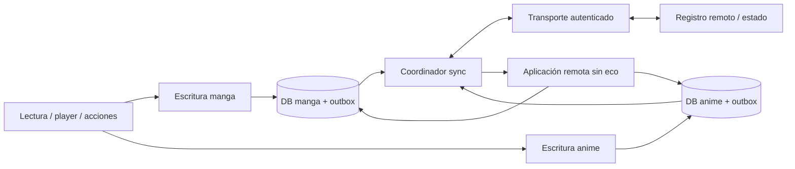

# Auditoría de backup/restore y propuesta de sincronización

Fecha: 27 de octubre de 2026. Base: `dev`, HEAD `056ad94b8025ca255ec31713ae0abe8d97036397`,
incluyendo el estado del árbol de trabajo al realizar la revisión.

## 1. Conclusión y alcance

El sistema actual contiene gran parte del **estado que queremos sincronizar**, pero el restaurador
no ofrece las garantías de una sincronización bidireccional. Usarlo periódicamente entre dispositivos
puede recuperar estados desmarcados, reemplazar posiciones recientes por antiguas y perder tiempo
de lectura realizado independientemente en dos dispositivos.

Recomiendo mantener `.tachibk` como mecanismo independiente de recuperación e importación inicial,
y construir un motor incremental que registre cambios junto con las escrituras locales. Las tablas
actuales pueden seguir alimentando la UI. No hace falta unificar las bases de manga y anime.

La revisión cubrió creación, formato, validación, restauración, opciones, preferencias, SQL,
repositorios, lectura/reproducción, historial, estadísticas y tracking. Se investigaron por separado
ambos stacks. Los defectos descritos son hallazgos del código; el diseño de las secciones 6–11 es una
propuesta y todavía no está implementado. No se modificó código funcional, configuración ni cambios
previos del usuario. No se realizó una prueba de dos dispositivos o una auditoría del backend.

## 2. Qué tenemos hoy

| Área | Manga | Anime | Límite para sincronización |
| --- | --- | --- | --- |
| Biblioteca | Fuente, URL, favorito, fecha de alta y metadatos | Equivalente | Identidad local por fuente/URL; no hay identidad global de obra |
| Progreso | Leído y última página | Visto, posición y duración del episodio | Es estado actual; no conserva intención ni ciclos de relectura |
| Marcas | Bookmark y memo | Bookmark y filler | Desmarcar necesita una operación explícita |
| Historial | Última fecha y duración acumulada por capítulo | Última fecha por episodio | Una fila por unidad, sin sesiones individuales |
| Categorías | Nombre, orden, flags y asignaciones | Equivalente | IDs locales; `hidden` no se respalda |
| Configuración por entrada | Flags del lector, capítulos, estrategia, scanlators excluidos, memo | Flags del player, episodios y temporadas | Mezcla datos personales, de fuente y de dispositivo |
| Series/temporadas | No aplica | Relaciones padre-hijo y atributos de temporada | Los IDs del backup solo sirven para remapear dentro de ese archivo |
| Tracking externo | Proveedor, IDs, progreso, score, estado, fechas, privacidad | Equivalente | No sustituye biblioteca, historial o métricas multidispositivo |
| Preferencias | App y fuentes configurables instaladas | Compartidas o paralelas según clave | Seis tipos; privados optativos; sin política de conflictos |
| Extensiones | Repositorios y APKs opcionales | Equivalente | Las APKs no son necesarias para sincronizar el estado personal |
| Botones mpv | No aplica | Contenido y configuración de botones | Deben tener tratamiento separado por contener comandos |
| Descargas/archivos | No se exportan los archivos ni la cola de descargas en el contrato | Equivalente | Deben tratarse como recursos locales o como una función adicional |

Evidencia: [BackupManga.kt, líneas 11–44][backup-manga], [BackupAnime.kt, 11–51][backup-anime],
[BackupChapter.kt][backup-chapter], [BackupEpisode.kt][backup-episode],
[Backup.kt, 44–62][backup-root], [PreferenceBackupCreator.kt, 31–85][pref-create],
[ExtensionsBackupCreator.kt, 18–46][extensions-create].

La selección incluye favoritos y, si se habilita, entradas fuera de biblioteca con leído/visto o
posición distinta de cero. **No exporta indiscriminadamente todas las filas**. Un elemento fuera de
biblioteca que solo tenga historial, memo o bookmark puede quedar fuera de esa selección.
Ver [mangas.sq, 92–101][mangas-sql] y [animes.sq, 99–108][animes-sql].

### Flujo de backup/restore

1. `BackupCreateJob` ejecuta la creación. Los creadores recorren entradas en lotes de 100 con límite
   superior de ID, consultan datos relacionados y emiten un título cada vez.
2. `BackupWriter` escribe protobuf comprimido con gzip. Mantiene el formato existente y evita
   cargar toda la biblioteca a la vez. Preferencias/APKs y demás metadatos tienen un manejo distinto.
3. Se valida el archivo generado; el decoder acepta protobuf crudo/gzip y formatos legacy.
4. Restore lee metadatos y almacena las entradas en un archivo temporal antes de aplicar cambios.
5. Restaura categorías, preferencias y entradas. Manga y anime pueden ejecutarse en paralelo;
   las temporadas anime se ordenan para restaurar padres antes que hijos y se detectan ciclos.
6. Cada título se restaura en una transacción de su base. Los errores por título se acumulan y el
   proceso continúa. No hay una transacción global que abarque las dos bases y preferencias.

Ver [BackupCreator.kt, 65–136][backup-create], [MangaBackupCreator.kt, 23–60][manga-create],
[AnimeBackupCreator.kt, 21–55][anime-create], [BackupStream.kt, 16–44 y 141–155][backup-stream],
[BackupRestorer.kt, 120–244][backup-restore] y [AnimeRestorePlan.kt][anime-plan].

La bandera `sync` de `BackupRestoreJob` llega a las notificaciones; **no implementa intercambio,
reconciliación ni transporte remoto**. Las tablas `manga_sync`/`anime_sync` son vínculos con trackers.
Ver [BackupRestoreJob.kt, 38–47 y 80–95][restore-job].

## 3. Hallazgos que conviene corregir o resolver antes de integrar sync

La prioridad indica el orden recomendado para este proyecto. Los límites de sync no implican por
sí solos que el comportamiento conservador de recuperación sea incorrecto para un backup.

### A1. Alta: el historial se restaura por URL global, sin padre ni fuente

`restoreHistory` consulta el historial y luego el capítulo/episodio usando solo la URL. Dos fuentes
o títulos pueden compartir una URL relativa. Si existen dos coincidencias, la consulta devuelve más
de una fila donde se espera una; si solo hay una, puede usarse el historial del padre equivocado.

Confirmado con una reproducción SQLite en memoria de las consultas reales: una URL bajo dos padres
devuelve dos filas. No se ejecutó el flujo Android completo de esa reproducción.

Corregir pasando el título restaurado y resolviendo `(parentId, url)` o el ID local del hijo de ese
padre. Aplica a ambos stacks. Evidencia: [MangaRestorer.kt, 322–345][manga-restore],
[AnimeRestorer.kt, 342–364][anime-restore], [history.sq, 25–34][history-manga],
[animehistory.sq, 23–31][history-anime].

### A2. Alta: preferencias de categorías anime usan el mapa de categorías manga

`BackupRestorer` entrega únicamente `backup.backupCategories` a `restoreApp`, pero
`PreferenceRestorer` utiliza ese mapa también para la categoría predeterminada anime. Para conjuntos
de categorías intenta mapear cada valor a ambos stacks, sin separar adecuadamente los destinos.
Con nombres/IDs diferentes puede omitir valores o mezclar IDs de categorías no correspondientes.

Se necesitan dos mapas de respaldo y remapeo según el stack de cada clave. Probar IDs coincidentes
con nombres distintos, IDs distintos, conjuntos vacíos y categorías no restauradas.
Evidencia: [BackupRestorer.kt, 151–157][backup-restore] y
[PreferenceRestorer.kt, 62–85 y 128–153][pref-restore].

### A3. Bloqueante para sync: unión y máximos no propagan la intención del usuario

Favorito/bookmark y leído/visto se conservan mediante unión de estados verdaderos. Anime también
conserva filler. Un dispositivo que desmarque o quite algo no puede propagar de forma fiable ese
cambio mediante restore. Las asignaciones de categorías solo se reemplazan si la lista resultante
no está vacía: quitar todas tampoco queda representado. Scanlators excluidos se unen.

Además, una posición no nula de un backup antiguo puede sustituir una posición local posterior
cuando ambos capítulos/episodios siguen incompletos. El merge de progreso no arbitra con una revisión
causal; `forComparison` excluye timestamp y versión. La restauración no es conmutativa en general.

Ejemplo: A tiene página 80; B aporta página 20 de un estado antiguo. Aplicar B puede dejar página 20.
Tomar siempre el máximo tampoco resuelve volver atrás deliberadamente o iniciar una relectura.

Ver [MangaRestorer.kt, 82–101, 145–188, 294–319 y 424–434][manga-restore],
[AnimeRestorer.kt, 83–104, 154–198 y 314–339][anime-restore] y
[SetReadStatus.kt, 21–34][set-read]/[SetSeenStatus.kt, 21–34][set-seen].

### A4. Bloqueante para métricas: acumulados sin procedencia no admiten una fusión exacta

Manga acumula `time_read`; restore toma el máximo entre los totales. Si ambos dispositivos parten
de 100 unidades y añaden 20 y 30, el resultado actual es 130; la actividad independiente sumaría
150. Sumar 120 + 130 daría 250 y duplicaría la base común. Ninguna fórmula sobre esos dos totales
puede descubrir qué parte comparten.

Anime no conserva tiempo activo ni sesiones en `animehistory`. El campo `readDuration` del modelo
de backup anime no se rellena con tiempo real de reproducción. No es posible reconstruir sesiones
pasadas que nunca se registraron.

Ver [history.sq, 3–9 y 73–85][history-manga], [MangaRestorer.kt, 338–355][manga-restore],
[animehistory.sq, 3–8][history-anime], [AnimeBackupCreator.kt, 101–102][anime-create] y
[BackupAnimeHistory.kt, 9–17][backup-anime-history].

### A5. Bloqueante para sync: versiones y timestamps actuales son parciales

Hay `version`, `last_modified_at` e `is_syncing`, pero no constituyen un registro completo de cambios:

- Títulos: el incremento de versión cubre URL, descripción y favorito; no todos los atributos.
- Capítulos/episodios: cubre leído/visto, bookmark y posición; no todos los datos, como filler.
- Asociaciones de categoría: hay incremento al insertar, pero quitar una asociación no tiene el mismo efecto.
- Historial y borrados no tienen un mecanismo equivalente de revisión/tombstone.
- Los timestamps de esos triggers usan segundos del reloj local. Las inserciones SQL parten con
  `last_modified_at=0`; no sirven como cursor incremental completo.
- Dos contadores locales iguales no representan el mismo estado ni ordenan cambios de dispositivos distintos.

Reproducciones SQLite sobre los triggers reales confirmaron que cambiar título/memo o filler no
incrementa versión, y que insertar una categoría incrementa pero borrarla no. La aplicación remota
tampoco debe reutilizar sin adaptación repositorios que fuerzan `isSyncing=0`.

Ver [mangas.sq, 37–64][mangas-sql], [animes.sq, 45–72][animes-sql],
[chapters.sq, 27–50][chapters-sql], [episodes.sq, 29–52][episodes-sql],
[mangas_categories.sq, 11–16][manga-categories-sql],
[ChapterRepositoryImpl.kt, 70–87][chapter-repo] y [EpisodeRepositoryImpl.kt, 70–90][episode-repo].

### A6. Alta para privacidad: incógnito tiene semánticas distintas

Reader evita persistir progreso e historial en incógnito. Player evita historial, pero guarda
progreso si `!incognitoMode || hasTrackers`. Puede ser una decisión deliberada del player, pero una
outbox que observe todas las escrituras subiría progreso de una sesión en incógnito.

La captura necesita contexto de privacidad y origen. Decidir explícitamente si ese progreso local
queda excluido también de futuras instantáneas de sincronización; excluir solo el evento inmediato
no basta si después se vuelve a exportar toda la fila.

Ver [ReaderViewModel.kt, 606–620 y 663–671][reader] y
[PlayerViewModel.kt, 1977–1982 y 2090–2115][player].

### A7. Media: huecos de recuperación y cobertura

- `history=true` con `chapters=false` exporta historial, pero en una instalación vacía restore lo
  omite si no encuentra el capítulo/episodio. Resolver la dependencia o advertirla al seleccionar opciones.
- `category.hidden` no se serializa; al restaurar categorías nuevas se fuerza `false`.
- `BackupOptions.canCreate()` omite `extensions`; seleccionar solamente APKs no habilita la creación.
- Categorías se identifican por nombre; los cambios de nombre/orden y el vacío necesitan identidad y operaciones propias para sync.
- Errores de preferencias se registran en logcat y no alimentan el resumen de errores del restore.

Ver [BackupOptions.kt, 11–20 y 38–43][backup-options], [MangaRestorer.kt, 327–335][manga-restore],
[AnimeRestorer.kt, 347–355][anime-restore], [BackupCategory.kt, 8–22][backup-category],
[MangaCategoriesRestorer.kt, 16–32][manga-category-restore] y
[PreferenceRestorer.kt, 122–124][pref-restore].

### A8. Alta para reutilizar tracking: colas anime/manga comparten almacenamiento

`DelayedMangaTrackingStore` y `DelayedAnimeTrackingStore` usan el mismo archivo SharedPreferences,
`tracking_queue`, y claves `trackId.toString()`. Los IDs pertenecen a bases independientes. Si
coinciden, una cola puede sobrescribir o eliminar la entrada de la otra; ambos lectores recorren
todas las claves del mismo archivo.

Además, `TrackEpisode` encola cuando detecta offline, pero una excepción de red estando online
solo se registra; `TrackChapter` sí tiene una ruta de encolado al fallar. Estas colas necesitan
correcciones y no son una base suficiente para la outbox nueva.

Ver [DelayedMangaTrackingStore.kt, 13–36][manga-queue],
[DelayedAnimeTrackingStore.kt, 13–36][anime-queue],
[TrackEpisode.kt, 36–56][track-episode] y [TrackChapter.kt][track-chapter].

## 4. Qué significan hoy las métricas

| Indicador | Cálculo actual | Interpretación y consecuencia |
| --- | --- | --- |
| Tiempo manga | Suma de `history.time_read` de todo el historial | Acumulado local; no conserva sesiones; puede perderse con borrado físico |
| Tiempo anime | Duración total si visto; posición si pendiente, en títulos de biblioteca | Estimación de contenido avanzado; seek, marcas manuales y rewatch alteran su significado |
| Contadores de biblioteca | Agregados de títulos, capítulos/episodios y marcas actuales | Deben recalcularse sobre entidades deduplicadas, no sumarse entre dispositivos |
| Descargas | Archivos locales y estado del gestor | Deben seguir indicando el dispositivo actual |
| Scores/tracking | Vínculos y datos de proveedores disponibles | Los servicios externos tienen su propia política y autenticación |

Las columnas anime `lastSecondSeen`/`totalSeconds` reciben **milisegundos**:
`PlayerViewModel` multiplica los segundos de mpv por 1000. El nuevo contrato debe indicar unidades
explícitas (`positionMs`, `durationMs`, `activeMs`) y evitar copiar los nombres engañosos.
Ver [PlayerViewModel.kt, 1969–1973][player], [AnimeStatsScreenModel.kt, 43–70 y 128–140][anime-stats]
y [MangaStatsScreenModel.kt, 53–70][manga-stats].

Quitar una entrada del historial puede poner su fecha en cero conservando duración; borrar todo
el historial elimina filas. La sincronización debe distinguir **ocultar del historial**, **borrar
actividad** y **reiniciar métricas**. Un backup antiguo no debe resucitar un borrado confirmado.
Ver [history.sq, 36–71][history-manga] y [animehistory.sq, 33–68][history-anime].

## 5. Atomicidad, formato y seguridad

Fortalezas reutilizables: streaming por título, lectura legacy, remapeo de IDs, spool temporal,
orden de temporadas y transacciones por entrada. El spool tiene acceso sincronizado y se elimina
al cerrar. No conviene sustituir estas garantías por un simple intercambio de archivos SQLite.

Límites confirmados del código:

- Las consultas de exportación se ejecutan por lotes y por relaciones, sin una instantánea global
  de ambas bases y preferencias. Una instantánea mixta bajo escrituras concurrentes es un riesgo
  inferido de ese flujo; no se reprodujo en dispositivo.
- El destino se escribe directamente y se valida después. El backup automático elimina versiones
  antiguas antes de terminar la nueva. Un fallo puede reducir la retención.
- El archivo se comprime, pero no se cifra ni autentica en esta capa. Los privados se excluyen
  por la marca de su clave, no mediante una lista explícita de información apta para nube.
- `BackupReader` permite longitudes hasta `Int.MAX_VALUE` sin cuotas prácticas para tamaño
  descomprimido/entradas. Las APKs se cargan juntas en memoria. La ingestión remota necesita límites.
- Restore puede terminar con errores por entrada y aun así el worker devolver `success`. Para sync
  hacen falta confirmaciones estructuradas por operación y un cursor que no avance sobre errores.

Evidencia: [BackupCreator.kt, 70–77, 86–136][backup-create],
[BackupStream.kt, 127–134 y 194–197][backup-stream], [BackupRestoreStore.kt][restore-store],
[BackupRestoreJob.kt, 46–56][restore-job] y [PreferenceBackupCreator.kt, 63–85][pref-create].

Compatibilidad a conservar: números protobuf y números retirados, valores por defecto, formatos
legacy y nombres serializados de las seis clases `PreferenceValue`. No reutilizar una clave de
preferencia con otro tipo. Añadir un campo raíz también exige revisar `METADATA_FIELDS` del lector;
modificar únicamente `Backup` puede hacer que se descarte en el paso de metadatos.
Ver [Backup.kt][backup-root], [BackupPreference.kt][backup-pref] y
[BackupStream.kt, 219–221][backup-stream].

## 6. Arquitectura propuesta

Propuesta: **estado local + operaciones incrementales + proyecciones actuales + transporte intercambiable**.
La UI continúa leyendo localmente. Un backend queda pendiente de selección; el protocolo y las
reglas de conflicto deben diseñarse antes de vincularlos a un proveedor.



Cada cambio local debe escribir **estado y outbox en la misma transacción de su base**. Hay dos
drivers/archivos SQLite independientes ([AppModule.kt, 82–130][app-module]); colocar toda la outbox
en una tercera base introduciría escrituras dobles sin atomicidad con manga/anime. Un coordinador
común puede drenar ambas colas sin fusionar los modelos de dominio.

Aplicar datos remotos debe actualizar proyección, deduplicación y cursor de ese stack en una
transacción, sin volver a emitir el cambio. Si el servidor entrega un stream mixto, conservar
checkpoints por stack o una recepción durable que permita reanudar tras aplicar solo uno.

El bootstrap y la resincronización necesitan una instantánea consistente **por stack** asociada
a su watermark/cursor. Las escrituras posteriores deben quedar registradas y reproducirse desde
ese corte. Exportar filas por lotes y después fijar el cursor a «ahora» puede omitir cambios ocurridos
durante la exportación. No se requiere una instantánea atómica entre ambas bases, pero sí un corte
verificable e independiente para cada una.

Separar borrados técnicos de intención personal: que una fuente deje de devolver un capítulo no
significa que el usuario quiera borrar su lectura. Las tablas actuales de historial tienen
`ON DELETE CASCADE`; las sesiones nuevas deben poder conservar su identidad y metadatos mínimos
aunque desaparezca la fila del catálogo local. Definir aparte eliminación de biblioteca y borrado
de actividad solicitado por el usuario.

Para preferencias globales sincronizadas conviene una tabla explícita transaccional como fuente
de verdad y una proyección hacia las preferencias existentes. Observar SharedPreferences y luego
escribir una outbox en otra base deja una ventana de pérdida. Empezar sin preferencias en el MVP.

Este enfoque es coherente con la guía oficial de [aplicaciones offline-first de Android](https://developer.android.com/topic/architecture/data-layer/offline-first),
que sitúa lectura local, escrituras encoladas y resolución de conflictos en la capa de datos.
Los detalles de outbox y reglas aquí descritos son una propuesta específica para este repositorio.

### Contrato mínimo propuesto

| Concepto | Campos o responsabilidad |
| --- | --- |
| Identidad | `entityId`, tipo manga/anime/capítulo/episodio, `parentEntityId`, aliases de fuente/URL |
| Operación | `operationId`, `deviceId`, secuencia por dispositivo/stream, tipo, payload y versión de protocolo |
| Conflicto | Revisión/contexto causal conocido, orden lógico y desempate determinista documentado |
| Outbox | Payload durable, estado pendiente/confirmado, reintentos; una por base |
| Inbox/aplicados | ID único de operación recibida y checkpoint, para idempotencia |
| Borrado | Tombstone o marcador de borrado con revisión y alcance |
| Sesión | `sessionId`, dispositivo, unidad, ciclo, checkpoint, duración activa acumulada, UTC de ocurrencia |
| Estado visible | Tablas actuales, actualizadas como proyecciones compatibles con la UI |

El backend debe autenticar y aislar cada cuenta/colección, aceptar reintentos con el mismo
`operationId` una sola vez y ofrecer paginación/cursor durable. El orden de recepción del servidor
por sí solo no expresa cuándo ocurrió una acción offline. No usar el reloj civil del teléfono ni
`version` actual como único árbitro.

### Identidad y equivalencias

Los `_id` SQLite no viajan como identidad compartida. Mapear una edición por
`(mediaType, sourceId, sourceUrl)` y sus hijos por `(parentEntityId, itemUrl)`, con IDs de sync
estables. Dos dispositivos que incorporan independientemente la misma edición deben converger:
el servidor puede hacer alta idempotente por esa clave, o el protocolo establecer una identidad
determinista con codificación canónica. UUIDs independientes sin reconciliación crearían duplicados.

Deduplicar esa clave en claro en el servidor revela la identidad del contenido. Si se elige cifrado
de extremo a extremo, resolver equivalencias en clientes o usar identificadores opacos deterministas
derivados con una clave compartida, documentando que pueden revelar igualdad. Un servidor que solo
ve ciphertext no puede ejecutar los mismos merges semánticos de un servidor que conoce los campos.

No identificar por título o número de capítulo/episodio. Fuentes, idiomas, extras y scanlators
pueden diferir. Conservar aliases cuando una fuente cambie de URL; no normalizar URLs agresivamente.
La equivalencia de una obra entre fuentes diferentes requiere vinculación explícita o un proveedor
de IDs, y debe ser una fase adicional. Para archivos locales, usar asociación explícita/manifiesto
o huella del contenido cuando sea viable; las rutas de cada dispositivo no son identidad universal.

Las temporadas anime deben referenciar `parentEntityId`; el remapeo/topología existente es reutilizable,
pero `BackupAnime.id` solo sirve dentro del archivo. No requiere cambiar la API pública de extensiones.

## 7. Reglas de conflicto propuestas

| Dato/acción | Regla recomendada |
| --- | --- |
| Favorito, bookmark, filler | Valor explícito por campo; operación posterior causalmente gana; empate concurrente determinista y visible cuando sea relevante |
| Leído/visto | Separar marca manual, completado automático y reset; un reset crea un ciclo nuevo |
| Posición para continuar | Última posición elegida dentro del ciclo; no máximo permanente; mantener máximo alcanzado como dato separado opcional |
| Relectura/rewatch | Ciclo o generación nueva; los eventos de ciclos anteriores no restituyen la posición vieja |
| Categorías | ID estable, cambios de nombre/orden independientes y altas/bajas de pertenencia explícitas, incluido conjunto vacío |
| Historial visible | Última actividad elegible derivada de sesiones, respetando ocultaciones y borrados |
| Duración | Una sola contribución por sesión/checkpoint; sumar sesiones distintas, no totales de dispositivos |
| Memo y ajustes elegibles | Revisiones por campo/clave; evitar reemplazar todo el título por una modificación parcial |
| Metadatos de fuente | Mantener procedencia y separarlos de decisiones personales; evitar retransmitir cada refresco del catálogo |
| Trackers externos | Adaptadores independientes; decidir autoridad por campo y evitar ecos sync → tracker → sync |

Para un reset concurrente con progreso de otro dispositivo, propongo dar prioridad al ciclo nuevo;
la actividad real del ciclo anterior puede conservarse en métricas sin cambiar el punto de
continuación. Es una decisión de producto que debe probarse con ejemplos antes de fijar el contrato.

No ejecutar automáticamente los efectos secundarios de una acción de UI al aplicar eventos remotos:
`SetReadStatus`/`SetSeenStatus` pueden borrar descargas según preferencias. Aplicar la proyección de
estado y decidir por separado si el dispositivo debe descargar/borrar archivos o actualizar trackers.
Ver [SetReadStatus.kt, 49–57][set-read] y [SetSeenStatus.kt, 49–57][set-seen].

### Métricas y sesiones

Registrar sesiones nuevas con IDs únicos y checkpoints de duración **absoluta acumulada por sesión**.
Recibir otra vez el mismo checkpoint no suma tiempo; recibir uno posterior actualiza esa sesión.
Usar reloj monotónico para duración y UTC para fecha de actividad. En anime, acumular reproducción
activa según una definición explícita que excluya pausas/buffering y no convierta seek en tiempo visto.
En manga, definir inactividad/pantalla apagada para que la métrica represente lectura con honestidad.

Separar dos indicadores: estimación de contenido consumido según estado actual y tiempo activo
registrado desde la nueva versión. Rewatch/relectura incrementa el segundo, sin inflar el primero.
Si dos dispositivos reproducen simultáneamente, decidir si la métrica suma tiempo de dispositivos
o tiempo personal sin solapamientos; no deduplicar sesiones distintas solo por proximidad temporal.

Importar el acumulado manga actual como **saldo legado con procedencia**. Si varios dispositivos
provienen del mismo backup, importarlo una sola vez. Con totales sin procedencia no es posible una
fusión exacta: proponer elegir una base o conservar el máximo como estimación documentada. El tiempo
anime histórico debe conservar su etiqueta de estimación; no convertirlo en sesiones ficticias.

## 8. Transporte: alternativas todavía abiertas

| Alternativa | Ventajas de diseño | Coste o límite |
| --- | --- | --- |
| Servidor propio con API de operaciones | Cursores, deduplicación y aislamiento centralizados; facilita varios escritores | Operación del servicio, cuentas, disponibilidad y recuperación |
| Servicio gestionado de datos | Puede acelerar autenticación/almacenamiento | Validar transacciones, conflictos, portabilidad, privacidad y coste del producto elegido |
| Almacenamiento personal, p. ej. Drive/WebDAV | Puede evitar operar un servicio de cuentas propio | Diseñar registro por dispositivo, publicación consistente, concurrencia y compactación según capacidades reales |
| Intercambiar backups completos | Reutiliza el formato para transferencia/importación | Mantiene los conflictos y pérdidas descritos; no satisface por sí solo sync bidireccional |

Mi preferencia técnica inicial para varios escritores es una API pequeña de operaciones con
almacenamiento remoto durable. Mantendría una interfaz de transporte para poder evaluar almacenamiento
personal sin reescribir las reglas. No se recomienda aquí un proveedor concreto: faltan requisitos
de alojamiento, usuarios, presupuesto, cifrado y latencia, y no se auditaron APIs de proveedores.

Con almacenamiento de archivos, preferir segmentos inmutables por dispositivo y un protocolo
explícito de publicación/descubrimiento/compactación; no varios dispositivos sobrescribiendo un único
`.tachibk`. Las garantías de escritura condicional/rename/listado deben verificarse para el proveedor.

Usar sincronización al abrir/reanudar y tras acciones relevantes, agrupando checkpoints; reintentos
persistentes con backoff y red disponible. WorkManager sirve para recuperación y trabajo diferido.
Su periodicidad mínima es 15 minutos y está sujeta a restricciones del sistema; no promete continuidad
inmediata entre dispositivos. Ver [documentación de WorkManager](https://developer.android.com/develop/background-work/background-tasks/persistent/getting-started/define-work).

## 9. Privacidad, recuperación y dispositivos antiguos

- Sincronizar por defecto biblioteca, estado y categorías; historial/métricas deben tener controles explícitos.
- Preferencias mediante lista permitida. Mantener locales rutas, descargas, colas, caché y ajustes dependientes del dispositivo.
- No transportar automáticamente tokens de fuentes/trackers, APKs ni comandos de botones dentro del stream personal.
- Crear un `deviceId` nuevo por instalación; no clonarlo con backup. No respaldar tokens, cursores ni outbox como preferencias comunes.
- Conservar la procedencia necesaria de sesiones/saldos en recuperación para no volver a contarlos como actividad nueva.
- Incorporar revocación de dispositivos, cierre de sesión seguro y protección contra aplicar datos de una cuenta a otra.
- Si se desea que el servidor no conozca biblioteca/historial, diseñar cifrado de extremo a extremo, emparejamiento,
  recuperación de claves y revocación desde el principio. TLS por sí solo no cumple ese requisito.
- Android Keystore puede proteger claves locales; no resuelve por sí mismo compartir/recuperar la clave entre dispositivos.
  Ver [Android Keystore](https://developer.android.com/privacy-and-security/keystore).
- Mantener tombstones hasta que los dispositivos admitidos hayan avanzado, o retirar dispositivos obsoletos y
  exigirles una resincronización completa. Un TTL arbitrario puede resucitar datos de un dispositivo offline.
- Versionar protocolo y capacidades. No confirmar silenciosamente una operación desconocida que el cliente no pudo aplicar.
- Restaurar un backup durante sync debe entrar por un modo explícito de importación: previsualizar reconciliación,
  conservar procedencia y registrar las nuevas decisiones sin reemitir todo como actividad recién ocurrida.

## 10. Implementación propuesta por etapas

| Etapa | Entregable | Criterio para avanzar |
| --- | --- | --- |
| 0. Endurecer restore | A1/A2, cobertura de hidden/dependencias y pruebas de roundtrip; corregir tracking A8 | Restore aislado por padre, opciones coherentes y regresiones cubiertas |
| 1. Contrato y políticas | Identidades, operaciones, ciclos, borrados, privacidad y reglas de concurrencia | Ejemplos de dos dispositivos convergen independientemente del orden de entrega |
| 2. Núcleo local | Migraciones en ambas DB, outbox/inbox y rutas de mutación transaccionales | Kill/retry/rollback no pierde ni duplica cambios; aplicar remoto no genera eco |
| 3. MVP de sync | Biblioteca, marcas, posición, categorías y relaciones de temporadas; transporte elegido | Continuar entre dos dispositivos y editar offline sin resucitar borrados |
| 4. Actividad y métricas | Sesiones, checkpoints, saldos legacy y estadísticas derivadas | Repetir/reordenar mensajes no cambia totales; relecturas y pausas tienen semántica comprobada |
| 5. Operación y alcance adicional | Recuperación, versiones, revocación, preferencias elegibles y puente a trackers | Pruebas de cuenta/dispositivo antiguo, límites, observabilidad y recuperación completas |

Puntos de integración: repositorios de manga/anime y capítulos/episodios, historial, categorías y
acciones de biblioteca; evitar una solución limitada a `ReaderViewModel`/`PlayerViewModel`, porque
también hay marcas manuales, migraciones, restauraciones y actualizaciones desde fuentes.

Conservar interfaces/modelos separados en `:domain`, implementaciones y migraciones en `:data`,
workers/transporte y configuración en `:app`, e inyección en los módulos existentes. Introducir
contexto de mutación (`local`, `remote`, `restore`, política de privacidad) donde se captura la intención.
No generar eventos personales para cada actualización de metadatos o caché.

## 11. Pruebas de aceptación necesarias

1. Misma edición añadida offline en dos dispositivos; IDs locales distintos y sin duplicados al converger.
2. Progreso offline concurrente, retroceso intencional, leído/visto manual y reset/relectura concurrente.
3. Favorito/bookmark/filler activado y desactivado; quitar última categoría, renombrar y reordenar categorías.
4. Dos padres/fuentes con la misma URL de capítulo/episodio; temporadas con padres faltantes o ciclos.
5. Entrega duplicada, inversa y parcial; respuesta perdida después del commit remoto; muerte del proceso entre pasos.
6. Borrar/ocultar historial y volver a conectar un dispositivo antiguo; borrar métricas como acción independiente.
7. Sesión con checkpoints repetidos, pausa, seek, buffering, rewatch y cambios de reloj/zona horaria.
8. Incógnito en ambos stacks, con/sin trackers, y exportación posterior para comprobar que no filtra actividad.
9. Instalar desde backup, importar el mismo backup dos veces y unir dos dispositivos con una base legacy común.
10. Cambiar de cuenta, revocar dispositivo, cliente viejo/capacidades desconocidas y límites de payload.
11. Aplicación remota de visto/leído sin borrar descargas o duplicar actualizaciones de trackers por accidente.
12. Roundtrip de backups actuales/legacy y de versiones futuras compatibles, con todos los tipos de preferencias.

## 12. Validación realizada y límites

Se ejecutó el wrapper del repositorio:

```sh
./gradlew :app:testDebugUnitTest --tests 'eu.kanade.tachiyomi.data.backup.*' --console=plain
```

Resultado: **39 pruebas aprobadas, 0 fallos, 0 errores** en cinco clases:

| Clase | Pruebas |
| --- | ---: |
| `BackupStreamTest` | 13 |
| `MangaBackupCreatorTest` | 6 |
| `AnimeBackupCreatorTest` | 6 |
| `AnimeRestoreOrderTest` | 7 |
| `BackupRestoreStoreTest` | 7 |

El primer intento no pudo escribir el lock del caché Gradle desde el sandbox; la repetición con
acceso autorizado al caché terminó correctamente. Hubo advertencias existentes de compilación y
deprecación. Las pruebas cubren streaming, compatibilidad de formato, creadores, spool y orden de
temporadas; **no demuestran ausencia de los defectos de merge, historial o preferencias encontrados**.
La afirmación de AGENTS de que no existen tests de backup está desactualizada respecto a este árbol.

También se realizaron reproducciones SQLite en memoria de consultas/triggers: colisión de URL de
historial, cobertura parcial de versiones y reemplazo de fecha de historial por una más antigua.
Son comprobaciones exploratorias; no se añadieron tests persistentes ni se modificó código funcional.
No se ejecutó la suite completa de release, un APK ni validación en dispositivo. Para este informe
se comprobaron enlaces locales y formato del diff. Los hallazgos de concurrencia de exportación y
la arquitectura propuesta necesitan pruebas específicas antes de considerarse validados en ejecución.

[backup-manga]: ../app/src/main/java/eu/kanade/tachiyomi/data/backup/models/BackupManga.kt
[backup-anime]: ../app/src/main/java/eu/kanade/tachiyomi/data/backup/models/BackupAnime.kt
[backup-chapter]: ../app/src/main/java/eu/kanade/tachiyomi/data/backup/models/BackupChapter.kt
[backup-episode]: ../app/src/main/java/eu/kanade/tachiyomi/data/backup/models/BackupEpisode.kt
[backup-root]: ../app/src/main/java/eu/kanade/tachiyomi/data/backup/models/Backup.kt
[backup-pref]: ../app/src/main/java/eu/kanade/tachiyomi/data/backup/models/BackupPreference.kt
[backup-anime-history]: ../app/src/main/java/eu/kanade/tachiyomi/data/backup/models/BackupAnimeHistory.kt
[backup-category]: ../app/src/main/java/eu/kanade/tachiyomi/data/backup/models/BackupCategory.kt
[pref-create]: ../app/src/main/java/eu/kanade/tachiyomi/data/backup/create/creators/PreferenceBackupCreator.kt
[pref-restore]: ../app/src/main/java/eu/kanade/tachiyomi/data/backup/restore/restorers/PreferenceRestorer.kt
[extensions-create]: ../app/src/main/java/eu/kanade/tachiyomi/data/backup/create/creators/ExtensionsBackupCreator.kt
[backup-create]: ../app/src/main/java/eu/kanade/tachiyomi/data/backup/create/BackupCreator.kt
[backup-options]: ../app/src/main/java/eu/kanade/tachiyomi/data/backup/create/BackupOptions.kt
[manga-create]: ../app/src/main/java/eu/kanade/tachiyomi/data/backup/create/creators/MangaBackupCreator.kt
[anime-create]: ../app/src/main/java/eu/kanade/tachiyomi/data/backup/create/creators/AnimeBackupCreator.kt
[backup-stream]: ../app/src/main/java/eu/kanade/tachiyomi/data/backup/BackupStream.kt
[backup-restore]: ../app/src/main/java/eu/kanade/tachiyomi/data/backup/restore/BackupRestorer.kt
[restore-job]: ../app/src/main/java/eu/kanade/tachiyomi/data/backup/restore/BackupRestoreJob.kt
[restore-store]: ../app/src/main/java/eu/kanade/tachiyomi/data/backup/restore/BackupRestoreStore.kt
[anime-plan]: ../app/src/main/java/eu/kanade/tachiyomi/data/backup/restore/AnimeRestorePlan.kt
[manga-restore]: ../app/src/main/java/eu/kanade/tachiyomi/data/backup/restore/restorers/MangaRestorer.kt
[anime-restore]: ../app/src/main/java/eu/kanade/tachiyomi/data/backup/restore/restorers/AnimeRestorer.kt
[manga-category-restore]: ../app/src/main/java/eu/kanade/tachiyomi/data/backup/restore/restorers/MangaCategoriesRestorer.kt
[mangas-sql]: ../data/src/main/sqldelight/data/mangas.sq
[animes-sql]: ../data/src/main/sqldelightanime/dataanime/animes.sq
[chapters-sql]: ../data/src/main/sqldelight/data/chapters.sq
[episodes-sql]: ../data/src/main/sqldelightanime/dataanime/episodes.sq
[history-manga]: ../data/src/main/sqldelight/data/history.sq
[history-anime]: ../data/src/main/sqldelightanime/dataanime/animehistory.sq
[manga-categories-sql]: ../data/src/main/sqldelight/data/mangas_categories.sq
[chapter-repo]: ../data/src/main/java/tachiyomi/data/items/chapter/ChapterRepositoryImpl.kt
[episode-repo]: ../data/src/main/java/tachiyomi/data/items/episode/EpisodeRepositoryImpl.kt
[set-read]: ../app/src/main/java/eu/kanade/domain/items/chapter/interactor/SetReadStatus.kt
[set-seen]: ../app/src/main/java/eu/kanade/domain/items/episode/interactor/SetSeenStatus.kt
[reader]: ../app/src/main/java/eu/kanade/tachiyomi/ui/reader/ReaderViewModel.kt
[player]: ../app/src/main/java/eu/kanade/tachiyomi/ui/player/PlayerViewModel.kt
[anime-stats]: ../app/src/main/java/eu/kanade/tachiyomi/ui/stats/anime/AnimeStatsScreenModel.kt
[manga-stats]: ../app/src/main/java/eu/kanade/tachiyomi/ui/stats/manga/MangaStatsScreenModel.kt
[manga-queue]: ../app/src/main/java/eu/kanade/domain/track/manga/store/DelayedMangaTrackingStore.kt
[anime-queue]: ../app/src/main/java/eu/kanade/domain/track/anime/store/DelayedAnimeTrackingStore.kt
[track-episode]: ../app/src/main/java/eu/kanade/domain/track/anime/interactor/TrackEpisode.kt
[track-chapter]: ../app/src/main/java/eu/kanade/domain/track/manga/interactor/TrackChapter.kt
[app-module]: ../app/src/main/java/eu/kanade/tachiyomi/di/AppModule.kt
